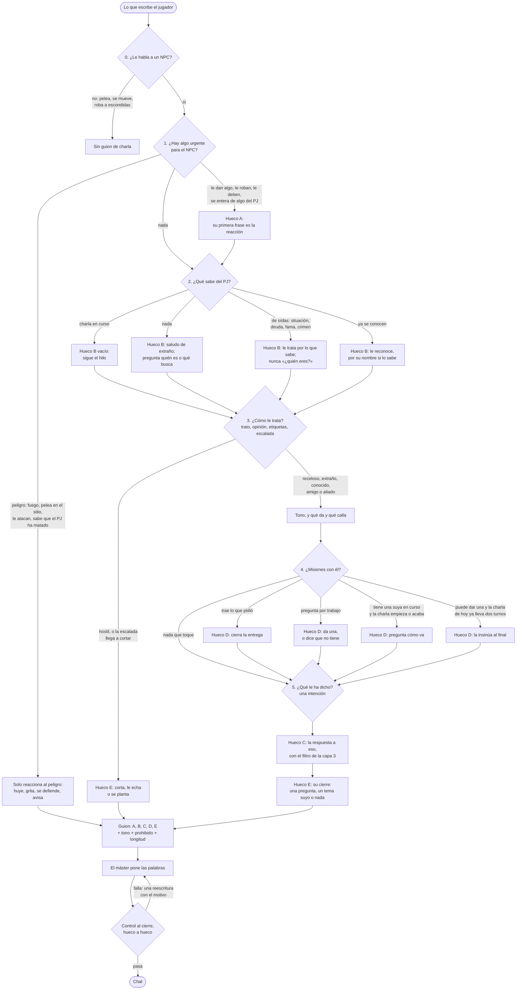

# Flujo de conversación de los NPC (propuesta para revisar)

Estado: **aprobado por Miguel e implementado el 06-11** (ver «Qué hay en la implementación», al final). Sus decisiones
del 06-11 están en «Decidido por Miguel». Sustituiría la elección de «una situación por
prioridad» de la v1 (`src/engine/talk.ts`, ver `CONVERSACION-REGLAS.md`) por un flujo de cinco capas que se evalúan
siempre en el mismo orden y rellenan los huecos de una respuesta. Todo sale del estado y de los datos de campaña: el
motor no sabe de Brezal ni de ningún NPC concreto.

## Idea en una frase

El motor recorre cinco preguntas, de lo más urgente a lo menos (**lo urgente, si le conoce, cómo le trata, misiones,
qué le ha dicho**) y con las respuestas monta un guion de cinco huecos en el orden en que habla una persona: **A**
reacción, **B** reconocimiento, **C** respuesta, **D** misión y **E** cierre. La IA solo pone las palabras de cada
hueco. El control al cierre comprueba cada hueco sin IA. Con Haiku, Sonnet o un modelo mayor la estructura es la misma;
solo cambia lo bien que suena. Con el máster offline, cada hueco se rellena con una plantilla.

La diferencia con la v1: hoy el motor elige **una** situación y, si hay otra, como mucho una segunda «si cabe». Por eso
la madurez de una misión se comía el saludo (Brenna) y el trato receloso se comía la pregunta (Garrán). Aquí las capas
**se suman**. Solo dos cosas cortan el turno: un peligro (capa 1) y el final de la escalada (capa 3).

## Lo que pasó en «Humo y ceniza» (VPS, 06-11)

Pillin, mediano y pícaro, empieza con la situación «deuda»: Brenna le dio cama y curandera, el regidor compró la deuda y
Garrán la cobra. En la apertura, Garrán le deja en la mesa **una tablilla con su nombre y la cifra** y se sienta
enfrente. Las dos están en `situation.knows` y Garrán es `antagonist_npc_id`.

| # | Jugador | Lo que decidió la v1 | Lo que dijo el NPC | Por qué falla |
|---|---|---|---|---|
| 21 | «Pedir una jarra a la tabernera» | `chat`, **primera vez que hablan**, extraño | Brenna: «Cuatro de cobre. Y que no sea de las de boca abajo.» Sin `buy_item`. | Brenna le dio cama: no es una desconocida. «Pedir una jarra» no se leyó como comercio. Le sirve sin cobrar. |
| 23 | «ir a hablar con garran» | `cold`, **primera vez que hablan** | Garrán: «¿Y tú quién eres, que vienes a sentarte a mi mesa?» | Garrán le acaba de dejar una tablilla con su nombre. La v1 solo cuenta como conocerse la transcripción y la memoria, y la apertura no entra. |
| 24 | «¿no sabes quién soy?» | `cold` + `question` | «Sé quién eres. El mediano de la cama de Brenna…» y, en la narración, «Ahí lo tienes.» | Contradice la línea anterior. No hay ninguna regla para «quién soy»: lo resuelve el modelo a ciegas. |
| 25 | «¿no sabe quién soy?» | igual | «Ya te lo he dicho, muchacho. Eres el que debe tres de oro…» y le manda a trabajar | Cuenta como negativa (`ALREADY_SAID`) y sube la escalera de negativas, cuando lo que hay es una pregunta que nadie contestó bien. |
| 47 | «ir hablar con Brenna» | `offer`, porque ya le contestó dos veces 20 minutos antes (`ripe`) | «Ya que lo preguntas. El de la puerta, **Tomás**, no ha cenado…» y `story_quest ask` | El jugador no preguntó nada. El máster le inventó la línea «Brenna, ¿tienes algo que hacer?»; el cierre la quitó (`saidByPlayer`), pero la respuesta de Brenna, que contestaba a esa línea, se quedó. El guardia es Doro: «Tomás» no existe. Sin saludo. |

Los cinco fallos salen de tres huecos de la v1: no hay una capa de **qué sabe el NPC del PJ** (solo mira si han
hablado), no existe la intención **abrir charla** («hablar con X» sin decir nada más) y la **madurez de una misión**
cuenta charlas de antes y gana a todo lo demás.

## El diagrama



Dos aclaraciones para leerlo:

- **Se evalúa en el orden 1 a 5; se habla en el orden A a E.** Una persona primero ve lo urgente, luego a quién tiene
  delante, luego cómo le cae, luego lo que tienen pendiente y, por último, atiende a lo que le dicen. Pero al hablar, la
  respuesta a lo que le han dicho (C) va antes que sacar una misión (D).
- **Lo que dice el jugador se lee una sola vez, al principio** (paso 0): la intención sirve de dato a todas las capas
  (por ejemplo, «pregunta por trabajo» en la capa 4). Lo que se decide en la capa 5 es la respuesta.

### La escalada (capa 3), que se mantiene

```mermaid
stateDiagram-v2
  [*] --> Calma
  Calma --> Molesto: insulto, burla o 2.ª negativa
  Molesto --> Calma: disculpa, regalo o salida perspicaz (nuevo)
  Harto --> Molesto: disculpa, regalo o salida perspicaz, si no ha cortado (nuevo)
  Molesto --> Harto: otro insulto o 3.ª vez con lo mismo
  Harto --> [*]: corta la charla y baja la confianza (harass)
  Harto --> Amenaza: el PJ amenaza o vuelve a la carga
  Amenaza --> Violencia: sigue, o le pone la mano encima
  Violencia --> [*]: pelea si es de pelear; si no, le echa o llama a la guardia
```



Es lo que ya hace la v1 con `reaction`, las negativas seguidas (`refusals`), la tirada de Intimidación (`presses`) y el
paso a hostil, que lleva al combate. Lo único nuevo son las flechas de vuelta: una disculpa, un regalo o una salida
perspicaz o creativa bajan un escalón (decidido por Miguel el 06-11, ver al final).

## Cada nodo

Columna «Fuente»: lo que existe hoy, con el fichero, o **nuevo** si hay que añadirlo al estado.

### 0. ¿Le habla a un NPC?

| Mira | Fuente | Resultado |
|---|---|---|
| A quién va: el que nombra, con quien ya habla o el único que tiene al lado si suena a charla | `talkTarget` (talk.ts) | El NPC del turno, o ninguno |
| Si suena a hablar o es una acción física (desenvainar, acercarse a escondidas, robar) | `soundsLikeTalk` (talk.ts) | Si es acción, no hay guion: el NPC reacciona por las reglas generales |
| Si puede hablar: vivo, despierto, no mudo | `status`, `down`, `mute` (model.ts) | Muerto, caído o animal: sin guion |
| Turno compartido (ronda o charla de grupo) | `sceneHints` (engine.ts) | Como hoy: sin guion (queda para después) |
| Su nivel: principal o relleno | **nuevo**: `tier: 'extra'` en el `Npc` (plan de relleno) | Principal: el flujo entero. Relleno: el mismo flujo con las capas recortadas (ver «Niveles de NPC») |

### Niveles de NPC: principal y relleno

El plan de relleno (`docs/PLAN-NPC-RELLENO.md`, rama `claude/npc-relleno-6f64c9`, sin implementar) añade vecinos con
oficio, nombre y rutina. No son un sistema aparte: recorren este mismo flujo con menos salidas en cada capa.

| Capa | Principal | Relleno |
|---|---|---|
| 0 | igual | igual |
| 1. Lo urgente | todas las banderas | igual; contesta con miedo (huye, grita, avisa) |
| 2. ¿Qué sabe del PJ? | cinco estados y el nombre | tres: nada, de oídas y «ya le ha hablado hoy» (un contador por PJ y día, sin memoria) |
| 3. ¿Cómo le trata? | trato, opinión, etiquetas, escalada | tono fijo por el carácter de su oficio, con la opinión y el crimen; a la segunda insistencia, le despacha y cierra |
| 4. ¿Misiones? | da, insinúa, recoge | nunca; si le piden trabajo, remite al tablón o a quien da trabajo |
| 5. ¿Qué le ha dicho? | todas las intenciones | seis: abrir o saludar, pregunta pública (su servicio), comercio, historia (no lo sabe y dice a quién preguntar), identidad, y todo lo demás (le despacha) |

Huecos: A, B, C y E, nunca D; dos frases y 25 palabras como mucho. Si la intención es una de las seis y es solo
hablar, el motor rellena los huecos con plantillas, sin llamar al máster (como hoy `talkReply` en offline). Si no, el
máster recibe el guion de relleno con esos huecos.

### 1. Lo urgente

Una bandera es **bloqueante** si el NPC no está para charlas: el turno es solo su reacción (y contestar si la pregunta
es sobre eso mismo). Las demás son de **primera frase** (hueco A): reacciona y sigue con lo demás.

| Bandera | Tipo | Fuente | Guion (hueco A) |
|---|---|---|---|
| Pelea en el sitio o un hostil delante | bloqueante | `encounterAt`, `hostilesAt` (encounter.ts) | Se aparta, se esconde, ayuda o pelea, según quién es |
| Fuego, derrumbe u otra alarma del sitio | bloqueante | **nuevo**: `location.alarm`, que pone un suceso del mundo definido en los datos o el máster con una tool (decidido) | Grita, apaga, saca a la gente, huye |
| El PJ le ataca o acaba de atacar a él o a los suyos | bloqueante | `recentDeed` = `attack` (talk.ts) | Se defiende, huye o llama a la guardia |
| Sabe que el PJ ha matado o herido a alguien | bloqueante | `npcCrimeLine` (crime.ts) | Miedo o rabia; no le atiende como a un cliente |
| Sabe que el PJ ha robado u otro delito menor | primera frase | `npcCrimeLine` (crime.ts) | Se lo echa en cara o se pone en guardia; baja el trato |
| Le han robado y lo ha notado | primera frase | incidente con él de víctima (crime.ts); sin testigos, **nuevo**: lo robado lleva `state.stolen` (ver «Robo sin testigos») | Si sabe o sospecha que fue el PJ, le acusa; si no, está alterado y pregunta si ha visto algo |
| Busca lo que le falta, o lo ve encima del PJ | primera frase | **nuevo**: `state.stolen` y lo que se ve del PJ | Lo reclama. La reacción al pillarle (broma, reproche, careo o delito) sale de `CONFLICTOS-NPC.md` |
| El PJ le acaba de dar, pagar o devolver algo | primera frase | `recentDeed` = `gift` (talk.ts); `transfer_item`, `pay_debt` | Lo agradece, se extraña o lo rechaza; mueve la confianza |
| El PJ le debe y el plazo ha vencido | primera frase | `openDebts` con `due_game_s` pasado (debts.ts) | Lo primero, la deuda |
| El PJ se fue sin pagar lo que le fió | primera frase | `openDebts` (debts.ts). Desde el 06-11 lo servido se cobra (`buy_item`) o se fía (`set_debt`), y el cierre rechaza servir sin una cosa ni otra (rama `claude/objetos-reales`) | «Me debes la jarra de antes» antes que nada |
| Se acaba de enterar de algo del PJ (una etiqueta o un hecho nuevo) | primera frase | `tagReactionsFor` sin `tags_seen` (standing.ts) | La nota de su `tag_reaction` |
| Está ocupado con otro PJ | modificador | `talking_to` (model.ts) | Le pide que espere o atiende a medias, salvo peligro |

#### Robo sin testigos (decidido por Miguel el 06-11)

«Creo que en la rama de NPCs tenemos que incluir el hecho de que echen en falta cosas que le han robado y las
busquen.» El reparto con el plan de conflictos (`docs/CONFLICTOS-NPC.md`, rama `claude/npc-conflictos-02da63`, sin
implementar):

- **Lo pone el plan de conflictos:** todo lo robado va a la mochila del PJ y queda marcado con `state.stolen`: de quién
  era, cuándo, el total de la tirada de Juego de manos y quién estaba cerca. También la reacción del NPC cuando le
  pilla, según la relación y su perfil. **La forma de `state.stolen` es la de ese plan** (sección 8 de
  `CONFLICTOS-NPC.md`): este flujo solo la lee, con el mismo nombre y los mismos campos.
- **Lo pone este flujo:**
  1. **Notarlo.** Al ir a usar lo robado (la llave del arcón) o al cambiar de actividad en su horario, su Percepción
     pasiva contra el total de la tirada. Si no llega, no lo nota esa vez.
  2. **Sospechar.** De quien estaba cerca según `state.stolen`; si era el PJ, la bandera «le han robado» lleva su
     nombre.
  3. **Buscarlo.** Mientras le falte, lo busca: lo dice a quien le habla, pregunta si lo han visto y, si sospecha de
     alguien, va a por él.
  4. **Reconocerlo.** Si lo ve encima del PJ (en la mano, equipado o al registrarle), la bandera pasa a «le ha pillado»
     y manda la reacción del plan de conflictos.

### 2. ¿Qué sabe del PJ?

Hoy la v1 solo distingue «primera vez» (sin transcripción ni memoria) y «ya han hablado». Propuesta: cinco estados,
calculados en este orden, y saber el nombre aparte.

| Estado | Cuándo | Fuente | Guion (hueco B) |
|---|---|---|---|
| Charla en curso | Le ha hablado en los últimos 15 min de juego | transcripción (`transcriptOf`, conversation.ts), `RECENT_S` | Nada: ni saludo ni presentarse; sigue el hilo |
| Reencuentro tras tiempo | Ya se conocen y no hablan desde hace más de 12 h | memoria y transcripción | Le reconoce y lo nota («cuánto tiempo») |
| Ya se conocen | Han hablado antes (memoria o transcripción), **o los puso juntos la apertura** | memoria, transcripción, `situation.with_npc_ids` y la escena de apertura | Le reconoce; recuerda lo último que hablaron |
| De oídas | No han hablado, pero el NPC sabe de él: es parte de su situación (antagonista, cobra su deuda, está en `situation.knows`), conoce un crimen suyo o una etiqueta | `situation` (model.ts), `termsWith` (talk.ts), `knownBy` (crime.ts), `npcKnowsTag` (standing.ts) | Le trata por lo que sabe de él («tú eres el que debe trescientos»); **nunca** «¿quién eres?» |
| Nada | Ninguno de los anteriores | | Saludo de extraño según su carácter; se presenta si su oficio lo pide; pregunta quién es o qué le trae |

**El nombre del PJ** (**nuevo**): hoy solo existe el lado del PJ (`pc.knows`, a quién conoce el PJ). Haría falta el
otro lado, `npc.knows_name_of: Id[]`, que se llena:

- con `situation.knows`, que se lee recíproco (decidido): si el PJ conoce a Brenna desde el principio, Brenna le
  conoce a él y sabe su nombre;
- cuando el PJ se presenta («me llamo Pillin», «soy Pillin») hablando con él, o le nombra alguien delante (la misma
  lógica que `introducedIn` en closecheck.ts, al revés).

Regla: el NPC usa el nombre del PJ solo si lo sabe; si no, le llama por lo que ve o por lo que sabe de él.

### 3. ¿Cómo le trata?

| Mira | Fuente | Guion |
|---|---|---|
| Trato: hostil, receloso, extraño, conocido, amigo, aliado | `talkTier` (concerns.ts): actitud y confianza (trust.ts) | El tono (`TALK_TIERS`) y la puerta: lo público siempre; lo delicado, lo que su nivel da (`knowledgeFor`) |
| Opinión | `opinionOf`, `opinionEffects` (standing.ts) | Matiza el tono y el precio (`priceFor`) |
| Etiquetas que conoce | `tagReactionsFor` (standing.ts) | Su nota, si ya reaccionó antes (la primera vez es bandera de la capa 1) |
| Escalada | `refusals`, `social_tried` (talk.ts), el insulto o la amenaza de este turno | Ver el diagrama de la escalada. Con «Harto» o hostil, hueco E: corta, y el turno acaba ahí |
| Convencer | `argues`, `presses` (talk.ts) | Tirada social antes de contestar lo delicado, una por charla (como la v1.3) |

La capa 3 **no es una situación**: es un filtro. Un NPC receloso contesta igual a lo que le preguntan; lo hace seco y
sin lo delicado. En la v1, `cold` ganaba a `question` y la pregunta quedaba «si cabe».

### 4. ¿Misiones con él?

| Caso | Cuándo | Fuente | Guion (hueco D) |
|---|---|---|---|
| Trae lo que pidió | Una suya está lista para entregar, o lleva el objeto, y dice que lo trae o lo da | `questStatus` = `ready`, `pending`, `delivery` (talk.ts, story.ts) | Lo reconoce y cierra la entrega con su tool; agradece según el trato |
| Pregunta por trabajo | Intención «pide trabajo» | `asks_work`, `can_offer`, `terms` (talk.ts) | Tiene: **una**, contada como la cuenta él (qué le pasa, por qué no va él, qué paga) y `story_quest ask`. No tiene: lo dice y, si lo hay, remite al tablón o a quien sí tiene. Lo suyo con el actor (`terms`): lo dice claro |
| Una suya en curso | La charla empieza o se despide, y tiene algo suyo en curso | `pending` | Pregunta cómo va, en una frase |
| Puede dar una y la charla está madura | **En esta charla** le ha contestado ya dos veces, el trato es extraño o mejor, y el jugador no pregunta otra cosa concreta | `can_offer`, `ripe` (cambiado: ver abajo) | La insinúa al final («si quieres ganarte unas monedas…»); la abre si el jugador sigue por ahí |
| Nada | | | Ni la nombra. Las que el PJ aún no puede coger, nunca (`locked`) |

Cambio de `ripe`: hoy cuenta las respuestas de cualquier charla de antes y la memoria, así que a Brenna le bastaba con
que hubieran hablado 20 minutos antes. Propuesta: solo cuentan las de **esta** charla, y el primer turno de una charla
nunca saca una misión que el jugador no ha pedido. El cierre del servidor (`askGate`, v1.4) se mantiene igual.

### 5. ¿Qué le ha dicho?

Una sola intención por turno (la principal). Si el texto no da una clara, el máster puede declararla en `log_event`
(hoy `talk_situation`; sería `talk_intent`) y el servidor la valida contra el estado, como ahora.

| Intención | Cómo se reconoce | Respuesta (hueco C) |
|---|---|---|
| Abrir charla (**nueva**) | «hablar con X», «me acerco a hablar con X», «voy a la barra a hablar con Brenna», sin nada más | Nada más que B y una invitación: «¿Qué quieres?» o lo que le diga su oficio («¿Qué te pongo?») |
| Saludo | «hola», «buenas»… | Devuelve el saludo (lo da B); si no hay más, una pregunta suya |
| Identidad (**nueva**) | «¿sabes quién soy?», «¿me conoces?», «soy X», «me llamo X», «¿quién eres?» | Desde la capa 2, exacto: si sabe de él, lo que sabe; si no, «no»; si se presenta, aprende el nombre y lo usa; si le pregunta quién es, se presenta (o se niega, según carácter y trato) |
| Contesta a lo que preguntó el NPC (**nueva**) | La última línea del NPC en esta charla era una pregunta | Reacciona a la respuesta antes de cambiar de tema |
| Pregunta pública | Dónde está o vive alguien, precios, horarios, qué es este sitio | Contesta siempre, aunque sea seco |
| Pregunta delicada o de historia | Secretos, rumores, el pasado, lo que esconde alguien (`loreTopics`, `knowledgeFor`) | Lo público del tema, su opinión y lo delicado según trato; si se niega, con salida (`wayOut`) |
| Pide trabajo | `asks_work` | La da la capa 4 |
| Entrega o da cuenta de una misión | `delivery` | La da la capa 4 |
| Comercio | comprar, vender, precio y también «pedir una jarra», «ponme», «sírveme» (**ampliado**; «pedir una jarra» ya entra en la rama `claude/objetos-reales`) | Precio exacto de su lista y la tool (`buy_item`, o `set_debt` si fía) |
| Da, regala o paga | `transfer_item` en el turno, «toma», «te pago» | Lo da la capa 1 (reacción) |
| Pide un favor | «necesito», «ayúdame», «¿me dejas…?» | Sí, no o qué querría a cambio, según trato |
| Convence o aprieta | `argues`, `presses` | Tirada, si lo que pide es delicado |
| Halaga | (**nuevo**, la v1 no lo detecta) | Según carácter: lo agradece o le suena a pelota (`dislikes_flattery`) |
| Calma o se disculpa (**nueva**) | «vale, vale», «perdona», «no te enfades» | Lo acepta o no según carácter; puede bajar un escalón la escalada |
| Insulta o se burla | `hostile` | Escalada: se ofende o se planta, y baja la confianza |
| Amenaza | `presses` sin nada que pedir, «te mato» | Escalada: se asusta, se planta o la devuelve |
| Se despide | `farewell` | Una frase; si hay deuda o encargo suyo, se lo recuerda (D) |
| Comenta sin más | Nada de lo anterior | Saca **un** tema suyo de lo que le ronda (`npcConcerns`) |

### Hueco E: el cierre

Lo que hace al acabar, por este orden: si la escalada corta, corta; si el hueco D insinúa una misión, esa es la
última frase; si es extraño y no se conocen, tantea (de dónde viene, qué busca); si no, una pregunta o un tema suyo, o
nada si ya ha dicho bastante. Nunca vuelve a preguntar «¿para qué lo quieres?» con la charla empezada (v1.1).

## El guion que recibe el máster

Ejemplo, turno 47 de «Humo y ceniza» con el flujo nuevo («ir hablar con Brenna»):

```
## Cómo responde Brenna en este turno
Abrir charla. Ya se conocen (le dio cama; hablaron hace 22 min); sabe su nombre: Pillin. Trato extraño.
A (lo urgente): nada.
B (reconocimiento): le reconoce y le llama Pillin. Sin presentarse.
C (respuesta): una invitación de tabernera: qué quiere, qué le pone.
D (misión): nada. Es el primer turno de esta charla y no ha pedido trabajo.
E (cierre): nada más.
Prohibido: misiones («La cena del portón»…); «ya que lo preguntas»; poner en boca del actor lo que no ha dicho;
nombres de gente que no está en el contexto.
Longitud: 25 palabras.
```

Una salida esperable: «Otra vez por aquí, Pillin. ¿Otra jarra, o vienes a algo?». Si el jugador contesta «¿tienes
algo que hacer?», el siguiente turno es «pide trabajo» y entonces sí, la cena del portón.

## Control al cierre, hueco a hueco

Todo sin IA. Si falla, una reescritura con el motivo (como hoy en `tools.ts`).

| Hueco | Comprueba | Hoy |
|---|---|---|
| A | Con bandera bloqueante, nada de comercio ni misiones (ni tools ni títulos) | parcial |
| A | Con regalo, una tool de confianza u opinión | no |
| B | Si sabe de él, no pregunta «¿quién eres?» ni «¿y tú quién eres?» | **nuevo** |
| B | No usa el nombre del PJ si no lo sabe | **nuevo** |
| B | Primer turno de una charla con quien no se conoce: hay saludo o reconocimiento | **nuevo** |
| C | Hay al menos una línea del NPC cuando le toca contestar | sí |
| C | Lo público y lo suyo con el actor no se niegan | sí (v1.1) |
| C | Negarse deja salida | sí (v1.3) |
| D | Títulos de misión solo si el hueco D lo permite; nunca las bloqueadas | parcial (bloqueadas y primer saludo) |
| D | El servidor no abre misiones fuera de la charla (`askGate`) | sí (v1.4) |
| Actor | Si el máster pone en boca del PJ algo que no escribió **y lo que dice el NPC se apoya en eso** (pregunta por trabajo, compra, una pregunta), reescritura, no solo quitar la línea | **nuevo** (hoy solo la quita) |
| Todo | La gente que nombra el NPC existe en los datos («Tomás» no) | revisar: hoy se coló |
| Todo | Longitud: la suma de los huecos que tiene el turno | sí, por situación |

## Casos de prueba

Todos se pueden probar sin API: el motor calcula el guion y el control se prueba con respuestas escritas a mano (bien y
mal). Con el máster offline, cada hueco con su plantilla.

| # | Entrada | Estado | Camino | Qué debe decir el NPC |
|---|---|---|---|---|
| 1 | «ir hablar con Brenna» | Le dio cama (situación); hablaron hace 22 min; puede dar «La cena del portón» | 2 ya se conocen; 5 abrir charla; D nada | Le reconoce por su nombre y le pregunta qué quiere. Sin misión |
| 2 | «ir a hablar con garran» | Garrán, antagonista; cobra su deuda; le dejó la tablilla con su nombre en la apertura | 2 ya se conocen; 3 receloso; 4 lo suyo en curso; 5 abrir charla | «Pillin. ¿Vienes a pagar?» y el plazo. Nunca «¿quién eres?» |
| 3 | «¿no sabes quién soy?» | Igual que 2 | 5 identidad | Lo que sabe: su nombre, la deuda, el plazo. Sin contradecirse |
| 4 | «¿no sabes quién soy?» (otra vez) | Ya contestado bien | 5 identidad; escalada Calma → Molesto | Lo mismo, en una frase y más seco |
| 5 | «Pedir una jarra a la tabernera» | Primera charla con Brenna, pero le dio cama | 2 ya se conocen; 5 comercio | Le reconoce, dice el precio y `buy_item` |
| 6 | «Hola» a Hugo | Nunca se han visto | 2 nada; 5 saludo | Saludo de extraño, se presenta si su oficio lo pide, pregunta qué le trae. Sin misiones |
| 7 | «Me llamo Pillin» a Hugo | Extraño | 5 identidad | Toma nota y usa el nombre desde ahora (`knows_name_of`) |
| 8 | «¿Dónde vive el regidor?» sin saludar | Extraño | 2 nada; 5 pregunta pública | Contesta (dónde vive y por dónde anda); B, como mucho, una mirada |
| 9 | «¿Cuánto vale la cerveza?» con la taberna en llamas | `alarm` fuego | 1 bloqueante | Solo el fuego. Nada de precio |
| 10 | «¿Qué pasa con el pozo?» justo después de darle 2 de plata | `recent` = gift | A; 5 pregunta | Primero la reacción al regalo, luego contesta |
| 11 | «Hola, Garrán» | Garrán fue a abrir el arcón, su pasiva superó la tirada del robo y el PJ estaba cerca (`state.stolen`) | A acusación; 3 baja | Le acusa o le exige antes de nada |
| 11b | «Hola, Garrán», con la llave colgada del cinto | Garrán la busca y la ve encima del PJ | A le ha pillado | La reacción del plan de conflictos: reproche, careo o delito, según la relación y su perfil |
| 12 | «Buenas» al prestamista | Deuda vencida | A deuda | Lo primero, la deuda |
| 13 | «Hola» a quien sabe que el PJ ha matado | `npcCrimeLine` asesinato | 1 bloqueante | Miedo o rabia, llama a la guardia. No le atiende |
| 14 | «Te traigo la cena de Brenna» al guardia | Misión en `ready` | 4 entrega | La reconoce, cierra la entrega con la tool, agradece |
| 15 | «¿Tienes trabajo?» a quien no tiene | `can_offer` vacío; hay tablón | 4 pide trabajo, sin nada | Dice que no y remite al tablón |
| 16 | «Qué frío hace esta noche» | Charla en curso, tercer turno, conocido, puede dar | 5 comentario; D insinúa | Comenta el frío y, al final, insinúa su encargo |
| 17 | «¿Qué esconde el regidor?» | Extraño; es delicado | 5 delicada | Se niega, con la salida (`wayOut`) |
| 18 | Lo mismo, otra vez | 1 negativa | escalada | Lo cierra en una frase y dice qué haría falta |
| 19 | Lo mismo, una tercera vez | 2 negativas | escalada: Harto | Corta la charla; baja la confianza (harass) |
| 20 | «Eres un inútil» | Calma | 5 insulto; escalada → Molesto | Se ofende o se planta; baja la confianza |
| 21 | «Vale, vale, no te enfades» | Molesto | 5 calmar | Lo acepta a regañadientes o no, según carácter |
| 22 | «Más te vale hablar o te parto la cara» | Pide algo delicado; no ha habido tirada | 5 aprieta; 3 tirada | Tirada de Intimidación antes de contestar |
| 23 | «Del sur, de Vharn» | El NPC acaba de preguntarle de dónde viene | 5 contesta a su pregunta | Reacciona a eso (y a la etiqueta, si la hay) antes de otro tema |
| 24 | «Adiós, Garrán» | Deuda abierta | 5 despedida; D | Una frase y el recordatorio del plazo |
| 25 | «Brenna, otra jarra» | Brenna habla con otro PJ | modificador ocupado | Le pide que espere o le sirve a medias |
| 26 | «Me acerco a su mesa y desenvaino» | | 0 no es charla | Sin guion |

## Comparación con la v1 (`talk.ts`)

| Pieza | v1 | Propuesta | |
|---|---|---|---|
| Señales de texto (`textSignals`) | Heurísticas en castellano | Las mismas y algunas nuevas: abrir charla, identidad, presentarse, calmar, halago, más formas de comercio | se amplía |
| Señales de estado (`talkState`) | Primera vez solo por transcripción y memoria | Lo que sabe del PJ, con la situación, la apertura, la fama y el nombre | **cambia** |
| Elegir | Una situación por prioridad y una secundaria «si cabe» | Cinco capas que rellenan huecos; solo cortan el peligro y la escalada | **cambia** |
| `cold` | Una situación que gana a la pregunta | Un filtro de tono: la pregunta se contesta igual | **cambia** |
| `ripe` | Dos respuestas de cualquier charla o memoria | Dos respuestas de esta charla, nunca en su primer turno | **cambia** |
| Lo público no se niega (v1.1) | Sí | Igual | se mantiene |
| Salida al negarse y negativas seguidas (v1.3) | Sí | Igual, dentro de la escalada | se mantiene |
| Tirada social (v1.3) | Sí | Igual | se mantiene |
| Lo suyo con el actor (`terms`) | Sí | Igual, y además cuenta como «de oídas» en la capa 2 | se mantiene |
| Puerta del servidor a las misiones (`askGate`, v1.4) | Sí | Igual | se mantiene |
| Escalada insulto, insistencia, amenaza, violencia | Sí | Igual, con la vuelta «Molesto → Calma» | se mantiene (+1) |
| Situación declarada por el máster | `talk_situation`, validada | `talk_intent`, validada igual | se renombra |
| Longitud | Por situación, +15 la secundaria, +25 de margen | Por huecos, +25 de margen | cambia la cuenta |
| Control | Contesta, misiones bloqueadas, primer saludo, negativas, «¿para qué?» de nuevo, longitud | Lo mismo y: «¿quién eres?» a quien conoce, nombre que no sabe, saludo en el primer turno, línea del actor inventada, gente inventada | se amplía |
| Máster offline (`talkReply`) | Una plantilla por situación | Una plantilla por hueco | cambia |
| Banderas de la capa 1 | Crimen, ataque, regalo | Y además: alarma del sitio, robo notado, deuda vencida, lo fiado sin pagar, etiqueta nueva | se amplía |

## Decidido por Miguel (06-11)

1. **`situation.knows` es recíproco.** Si la situación dice que el PJ conoce a Brenna y a Garrán, ellos le conocen a
   él y saben su nombre (`knows_name_of` se llena con eso al crear el PJ).
2. **Las alarmas del sitio las ponen las dos cosas.** Un suceso del mundo definido en los datos de la campaña (como los
   sucesos con hora de hoy) o el máster con una tool, para lo que surge en la partida (un candil que prende la paja).
   Las dos escriben el mismo `location.alarm`, que la capa 1 lee como bandera bloqueante.
3. **La escalada puede bajar un escalón** (de Molesto a Calma, o de Harto a Molesto mientras no haya cortado la
   charla). La bajan una disculpa, un regalo y también ser perspicaz o dar una solución creativa al problema del NPC.
   Cómo se detecta:
   - la disculpa, por el texto (intención «calma»);
   - el regalo, por el estado (`recentDeed` = `gift`);
   - la salida perspicaz o creativa no la puede leer una heurística: la declara el máster en `log_event`
     (`talk_deescalate`, con el motivo) y el servidor la acepta solo si la escalada estaba por encima de Calma. Si el
     jugador la apoya con una tirada (Perspicacia o Persuasión), cuenta el resultado.
   Su carácter decide cuánto le cuesta: a quien es rencoroso, solo el regalo o la solución le bajan.
4. **Misión madura: la insinúa y espera.** El NPC la deja caer al final (hueco D) y no la abre hasta que el jugador
   muestre interés (pregunta por ella, se ofrece o dice que sí). Entonces es «pide trabajo» y sale entera, con
   `story_quest ask`.

También decidido el 06-11: lo que se sirve se cobra o se fía, y el cierre rechaza servir sin una cosa ni otra; el
contexto dice qué lleva cada NPC, y un robo contado sin que nada cambie de manos se rechaza. Y los NPC echan en falta
lo que les roban y lo buscan (ver «Robo sin testigos», en la capa 1).

No queda ninguna pregunta abierta. Falta que Miguel apruebe el flujo para empezar a implementarlo.

## Si se aprueba: por dónde empezar

1. Capa 2 (qué sabe del PJ y `knows_name_of`) y las intenciones abrir charla e identidad: arreglan los cinco fallos de
   «Humo y ceniza».
2. El nuevo `ripe` y el control de la línea del actor inventada.
3. Los huecos en el guion y en el control, sustituyendo la situación única.
4. Las banderas nuevas de la capa 1: el robo notado y buscado, cuando exista `state.stolen` (plan de conflictos), y
   las alarmas del sitio (`location.alarm`, desde los sucesos del mundo y desde una tool del máster). Con ellas, las
   flechas de vuelta de la escalada y `talk_deescalate`.

5. El nivel de relleno dentro del flujo, cuando entre su plan.

Cada paso con sus tests sin API (los casos de arriba) y, al final, una prueba con Haiku que deja escrita Miguel (el
comando y el coste).

**Integración.** Todo sale en un único PR que lleva la sesión principal en la rama local `claude/integracion-npc-objetos`.
Este flujo va el último (objetos, conflictos, relleno y después este), porque reorganiza `talk.ts`, que los demás tocan.
Antes de implementar: `git merge claude/integracion-npc-objetos` en esta rama, que ya trae «pedir una jarra» como
comercio, el cobro al servir en el guion y los controles `stolenWithoutTool` y `servedWithoutPay`. Un commit por fase,
sin push ni PR. Los tests se pasan todos al final; mientras, como mucho `npx tsc --noEmit -p .`.

## Qué hay en la implementación (06-11)

- **`src/engine/talk.ts`**:
  - Capa 2: `knows` (`talking`, `returning`, `known`, `heard`, `none`), `knows_pc_name` y `heard_of`. `situation.knows` es
    recíproco y la apertura (`with_npc_ids`) cuenta como conocerse. `first_meeting` ya no es cierto para quien conoce al
    PJ por su situación.
  - Capa 1: `flags` (alarma, ataque, crimen grave o leve, robo notado o pillado, regalo, deuda vencida, ocupado). Las
    bloqueantes dejan solo el hueco A.
  - Capa 3: `escalation` (`calm`, `annoyed`, `fed_up`): insultos y amenazas suben, una disculpa, un regalo o
    `talk_deescalate` bajan, y las negativas seguidas suman. Harto y otro insulto o amenaza: `cut`, corta la charla.
  - Capa 4: `ripe` cuenta las respuestas de esta charla y nunca en su primer turno; la madura se insinúa (hueco D) y sale
    con «pide trabajo» o con un «sí» a lo que dejó caer (`hinted`, `affirmative`).
  - Capa 5: `intentOf` y `TALK_INTENTS`; señales nuevas: `opens`, `identity`, `introduces`, `asks_who`, `calm`,
    `flattery`, `affirmative`.
  - `talkHoles` (A a E) y `talkScript` por huecos. La situación (`situation`, `second`) se mantiene como etiqueta para
    la puerta de las misiones (`askBlocked`, `offersNow`), la longitud y `talk_situation`.
  - Control (`talkProblems`): «¿quién eres?» a quien conoce, decir que no le conoce cuando sí, usar el nombre del PJ
    sin saberlo, contestar a lo que no ha dicho («ya que lo preguntas») y nombrar una misión que no le han pedido.
  - Relleno (`npc.tier === 'extra'`): el mismo flujo con seis intenciones, sin hueco D y 25 palabras.
- **`src/engine/alarm.ts`**: `location.state.alarm`. La ponen la tool `set_alarm` del máster y el efecto `alarm` de las
  reglas del mundo (`worldrules.ts`). El contexto del máster la lleva en una línea propia.
- **`src/engine/stolen.ts`**: lee `item.state.stolen` (forma `StolenMark`, compartida con el plan de conflictos), lo
  nota una vez por hora de juego con la pasiva contra la tirada (`noticeThefts`, en la pasada de incidentes del motor)
  y dice a la charla si lo echa en falta, sospecha del PJ o lo ve encima (`theftWith`).
- **`src/ai/tools.ts`**: `set_alarm`; `talk_deescalate` en `log_event` (solo vale con tensión); la línea del actor
  inventada en la que se apoya el NPC se reescribe; presentarse («me llamo…», `introduces_self`) apunta el nombre en
  `npc.knows_name_of`.
- **`src/ai/offline.ts`**: el máster offline lee los huecos (peligro, cortar, abrir charla, quién es quién).
- **Tests** (`test/conversacion-flujo.test.ts`): los casos de «Humo y ceniza» y de la tabla, sin API. Ajustados los que
  daban por hecho que la misión madura salía sola o que el receloso era una situación.

**Pendiente o fuera:** el control de «gente inventada» (el guardia «Tomás») lo propone también el plan de relleno y se
hace una sola vez, allí. `talk_situation` no se ha renombrado a `talk_intent` (la intención la decide el motor). La
bandera «se acaba de enterar de una etiqueta» sigue en las líneas de reputación del NPC (`npcStandingLines`), no en la
capa 1. Notar un robo «al ir a usarlo» se aproxima con el cambio de actividad (una vez por hora de juego).
