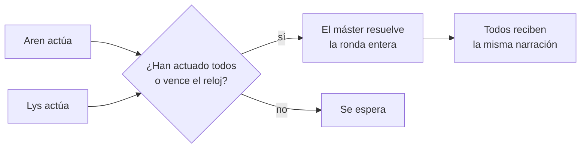

> [!abstract] En corto
> El combate es una conversación, no una cuadrícula de turnos. Empieza de forma natural en la narración, el servidor tira y aplica el daño, y solo en momentos críticos se abre una ventana de respuesta con reloj. Con varios jugadores en una pelea, las acciones se juntan en rondas. Desde el 27 de octubre de 2026, los enemigos atacan **en cada turno** aunque el máster se olvide, pegar a alguien hasta tumbarle le deja **inconsciente** y no muerto, y nadie es inmortal.

## Cómo empieza

- No hay botón de «empezar combate». Empieza cuando la ficción lo pide.
- **Solo hay combate con hostilidad de verdad**: un ataque resuelto, daño a alguien o un testigo que se lanza a pelear por un crimen. Un robo pillado, un forcejeo o una amenaza no lo abren: se resuelven con su tirada y la reacción del NPC (agarrarte, gritar, avisar a la guardia). Desde la partida del 4 de noviembre de 2026.
- **Se acaba en cuanto no queda ningún hostil**: caídos, muertos, idos del sitio o calmados (aceptan una disculpa, se dejan convencer o se amilanan). Unos segundos después del último golpe sale «Fin del combate». Si alguien vuelve a atacar, es otro combate.
- El máster lo marca por dentro para llevar puntos de golpe, condiciones y quién está implicado.
- **Sin prisa.** El orden lo dan las respuestas de los jugadores. La iniciativa 5e solo sirve de desempate.
- Huir es moverse como siempre. Los enemigos pueden perseguirte según su velocidad.

## Atacar

1. Dices a quién atacas.
2. El máster pide el dado con el objetivo.
3. El servidor tira contra la CA del enemigo, calcula el daño del arma que llevas en la mano (crítico con 20) y lo aplica.
4. El máster narra el resultado.

- Los **enemigos** usan bloques del SRD (CA, PG, ataque, daño, experiencia). Sus tiradas son ocultas.
- Un NPC muerto **suelta lo que lleva** y da experiencia a quien lo vence. Si no era hostil, no hay experiencia sino infamia, y es un crimen con testigos. Ver [[Mecánicas#Crimen, testigos y ley]].
- Quien te ataca primero queda hostil contigo: devolverle el golpe no es un crimen.
- Los NPC tienen una **actitud** hacia cada personaje: de hostil a aliado.

## Los enemigos actúan siempre

- **Cada turno, cada NPC hostil hace el suyo.** Un turno es tu acción, o la ronda entera si sois varios. Todo NPC hostil que sigue en pie, suelto y en tu mismo sitio ataca, con su **multiataque** si lo tiene (el matón, el explorador y el veterano del SRD dan dos golpes).
- **Si el máster no lo hace, lo hace el motor.** Al cerrar el turno resuelve el ataque (el que pelea cuerpo a cuerpo se lanza hasta ti) y le pide al máster que lo cuente. Si aun así no lo cuenta, lo añade el motor al final de la narración. El máster lo narra, pero no se lo puede saltar.
- **Un turno por NPC.** No ataca dos veces en el mismo turno.
- **Cuándo no:** si el máster te pide una tirada (el turno acaba al tirar), si abre una ventana decisiva con ese enemigo, o si el enemigo ya ha caído.
- **Entran también los que se meten** por un crimen: la víctima que se defiende, el amigo que salta y la autoridad si te resistes. El resto de la autoridad **acude** como apoyo. Ver [[Mecánicas#Crimen, testigos y ley]].
- **Quien pelea no sigue su horario:** el herrero no se vuelve al yunque en mitad de la pelea.
- **No rematan al caído:** un PJ a 0 PG deja de ser objetivo y tira sus salvaciones. Ver [[Muerte y descanso]].

## Golpe no letal

A 0 PG, un NPC **cae inconsciente** en vez de morir si:
- le das con un arma **contundente** (bastón, maza, martillo) o con los **puños**,
- o dices que le **pegas**, le **golpeas** o le **reduces**.

**Muere** si dices que quieres matarle («lo mato»), si el arma **corta o perfora** y no dices lo contrario, o si **rematas** a quien ya está en el suelo. Lo decide el servidor con lo que escribes y el arma, no el máster.

Al **inconsciente**:
- Se le ve en el suelo («Hugo, inconsciente, aquí mismo») y en la cabecera del combate.
- **Vuelve en sí** con 1 PG a las dos horas de juego, o antes si le curan.
- Se le puede **atar**: atado no se mueve ni pelea, aunque despierte, hasta que le suelten.
- Se le puede **registrar** sin tirada, pero si alguien lo ve es un robo.
- Se le puede **rematar**: el golpe entra solo y le mata. Es una muerte grave, sin experiencia, aunque empezara él.
- Vencer a quien atacaste sin motivo no da experiencia.

## Nadie es inmortal

- No hay NPC «esenciales» que no se puedan matar. Lo que sostiene la trama tiene un **plan B** en los datos: si muere quien da una misión o guarda una pista, otro toma el relevo o aparece lo que dejó. Ver [[Misiones]].
- El motor avisa de la muerte o de la inconsciencia con la causa y quién fue, y las misiones lo leen.

## Bloques por rol

Como ahora los enemigos pegan en cada turno, los bloques del SRD sin más son demasiado para un PJ de nivel 1 solo: contra un matón con dos golpes por turno, un mago gana el 1 % de las veces y un guerrero el 21 %. La gente de una campaña lleva un bloque según su oficio, con **un golpe fuerte por turno**:

| Quién | Bloque | Gana un guerrero | Gana un mago |
|---|---|---|---|
| [[Hugo]], el herrero | CA 12 (mandil), 22 PG, martillo de fragua 1d8+2 | 66 % (unos 5 turnos) | 38 % (unos 3 turnos) |
| [[Garrán]], el alguacil | CA 13 (jubón), 24 PG, maza corta 1d6+2, y [[Doro]] acude | 69 % solo contra él | 34 % |

Son simulaciones de un PJ de nivel 1 contra uno solo, sin trucos. Un adulto fuerte ya no cae en dos turnos sin riesgo, pero se le puede ganar. Perder no es morir: caes a 0 PG y tiras salvaciones, y si fue la autoridad, despiertas en el calabozo.

> [!example] Hugo, en la partida del 27 de octubre
> Hugo solo atacó en 3 de los 6 turnos de Leodhin, nunca con los dos golpes del matón, y un bastonazo a 0 PG le mató. Ahora ataca en cada turno, y ese bastonazo le deja inconsciente; «lo mato» le mata. Ver [[Revisión partida 2026-10-27]].

> [!example] El lobo gris
> En la demo hubo un lobo gris en el arroyo del claro: CA 13, 11 PG y un mordisco de 2d4+2.

## Ventanas decisivas

En un momento crítico (el hacha que cae, el puente que cede), el máster abre una **ventana de respuesta** de 60 segundos, con contador y acciones sugeridas.

| Respondes en… | Efecto |
|---|---|
| Menos de 15 s | Ventaja, o actúas antes de que la amenaza se resuelva |
| Entre 15 y 60 s | Acción y amenaza a la vez; decide el dado |
| Más de 60 s | La amenaza se cumple contra ti, daño completo |

- Solo se abre con **riesgo real e inmediato**, validado por el servidor.
- Nunca dos seguidas al mismo personaje.
- No responder es perder de verdad. Un jugador **ausente** no queda indefenso: se defiende con su CA y sus salvaciones.

## Rondas en escenas tensas

Con dos o más jugadores activos en el mismo sitio y una pelea de verdad, las acciones entran en **rondas**.

- Pelea de verdad: un combate en curso, un enemigo hostil delante o una ventana decisiva abierta. Un sitio tenso por la historia (en Brezal, la noche de la Brasa en la plaza) ya no basta: sin pelea, lo que hacéis a la vez lo junta la **ventana de turno** (ver [[Multijugador]]).
- Cuando han actuado todos, o pasan 30 s, el máster resuelve **la ronda entera** en una sola respuesta, y cada uno lee lo suyo más lo que hace el mundo.
- Quien no actuó **duda** y pierde la ronda, sin bloquear a nadie.
- La interfaz enseña un aviso con la ronda, a quién se espera y el tiempo que queda.
- Una ronda es **una sola llamada al máster**, no una por jugador.

## Lo que dice la spec y aún no está

- Hechizos con resolvedor por nombre y **barra rápida** de 5 conjuros.
- Dificultad que escala con el número de jugadores.
- Combate táctico por casillas: descartado por ahora; el tablero tiene cuadrícula de 1,5 m pero no se usa para el combate.

## Relacionado

- [[Muerte y descanso]] · [[Mecánicas]] · [[Multijugador]] · [[El máster IA]]
