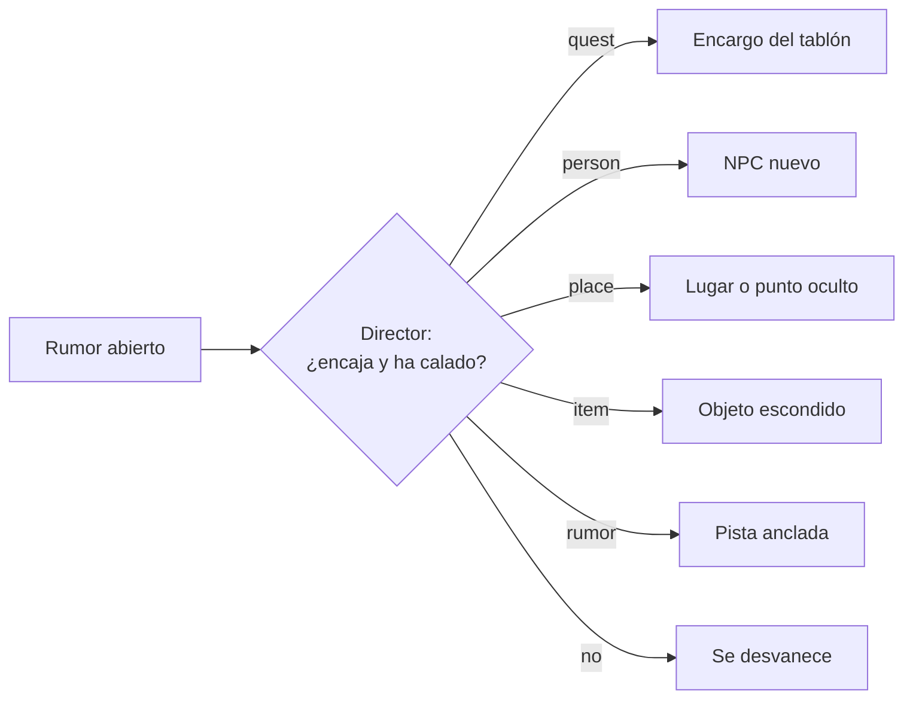

> [!abstract] En corto
> El máster tiene creatividad acotada: no puede inventar cosas en el mundo, pero sí rechazar lo imposible con ingenio, sembrar rumores ante lo que no existe y aceptar con condiciones lo que el jugador cuenta de su propio personaje. Un futuro Director convertirá los rumores que más interesen en trama real.

## El problema

«La base de datos es la verdad» choca con la improvisación de un buen máster. Si el jugador pregunta por algo que no existe, ¿qué hace la IA? La respuesta son tres casos y unas leyes.

## Tres respuestas

| Caso | Qué hace el máster | Ejemplo de criterio |
|---|---|---|
| **Imposible** | Lo rechaza **con ingenio**, en ficción, sin decir «no puedes» | No crea nada, no pide tirada, no regala |
| **Plausible pero no existe** | Siembra un **rumor**: algo que «se dice», no algo que está | No crea objetos ni lugares |
| **El jugador inventa sobre su personaje** | Lo apunta como **hecho de personaje**: verdad para él, no para el mundo | No le da nada gratis |

Y si la acción es ambigua, **pregunta** antes de ejecutar.

## Las piezas

| Pieza | Qué es |
|---|---|
| **Leyes del mundo** | Una frase por ley (hay magia o no, qué está prohibido). Sin leyes propias, las de fantasía del SRD. Van en las instrucciones del máster. |
| **Rumores** | Circulan por un lugar, con procedencia: quién, dónde y cuándo. Si lo dice el jugador, sale como «lo dice Kael, sin confirmar». |
| **Hechos de personaje** | Su pasado, sus recuerdos, gente que no está en escena. Solo valen para él. |

**Topes**

- Rumores: 3 nuevos por personaje y día de juego; caducan a los 7 días; como mucho 10 vivos por lugar.
- Hechos: 5 por día y 24 en total por personaje.

## Del rumor al hilo: el Director

El **Director** es un segundo agente, fuera de la partida. No habla con jugadores. Está diseñado y aún no está construido.

- Recorre los rumores abiertos y pesa cuántas veces se mencionan, cuántos jugadores los tocaron y si encajan con la premisa y la Biblia.
- Los que encajan los convierte en datos reales a través del motor.
- Lo que no encaja caduca y queda como «desvanecido».

En la spec, el Director también escribe la **trama principal**: corre tras cada hito y una vez por día de juego, lee la crónica y crea, concreta o cierra hilos. Sus guardarraíles:

- todo hilo nuevo nace de **algo que pasó de verdad** o de una verdad de la Biblia;
- no contradice la Biblia ni lo registrado;
- máximo 3-4 hilos inmediatos abiertos a la vez;
- siempre al menos un gancho alcanzable desde donde hay jugadores;
- empieza en **modo borrador**: lo que propone espera aprobación.

## Banco de creatividad

Un banco de **25 prompts**, todos con Kael en la barra de la taberna, cada uno en una partida nueva. Mide si el máster responde como debe.

| Criterio | Prompts | Cumple si… |
|---|---|---|
| Rechazo con ingenio | 7 | No siembra, no regala, no pide tirada, no dice «no puedes» y tiene algo de cuerpo |
| Rumor | 6 | Siembra un rumor bien y no crea objetos |
| Pregunta | 4 | Pregunta y no ejecuta nada |
| En ficción | 4 | No rompe la cuarta pared, sin cifras de reglas, sin regalar |
| Hecho de personaje | 2 | Lo apunta bien, sin regalar |
| Rumor del jugador | 1 | Lo siembra como dicho por el jugador |
| Condicional | 1 | No regala la ventaja: tirada, coste o pregunta |

- El juicio automático es un primer filtro. El ingenio se lee a mano en el informe.
- Coste estimado por pasada (unas 35 llamadas): **≈ 0,04 $** con Haiku 5.5 y **≈ 0,74 $** con Sonnet 5.5.
- A fecha del documento, aún no se había hecho ninguna pasada real.

## Relacionado

- [[El máster IA]] · [[Mundos generados]] · [[Historia]]
