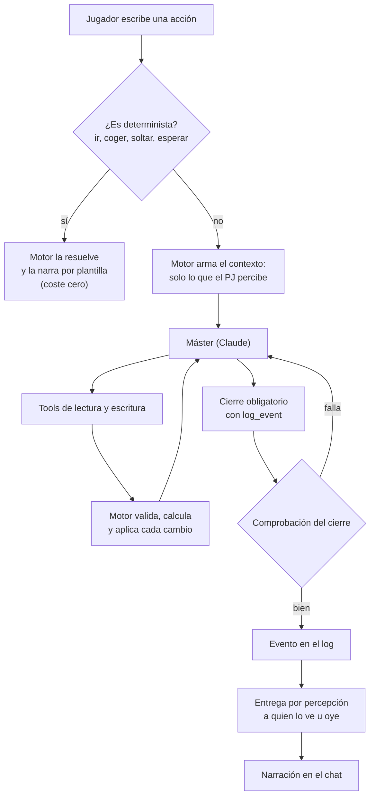

![[ilustracion-mesa-master.jpg]]
*La mesa del máster: dados, mapa y libro de cuentas. El motor lleva la cuenta; la IA narra.*

> [!abstract] En corto
> El máster es Claude. Hace una llamada por acción: lee lo que el personaje percibe, cambia el mundo solo a través de tools y cierra siempre con un registro del evento. El motor valida cada cambio, tira los dados y comprueba el cierre antes de dárselo al jugador. Se puede jugar sin gastar con los modos offline y de grabación.

## Qué hace y qué no

| El máster sí | El máster no |
|---|---|
| Narra lo que pasa y da voz a los NPC | Tira dados (lo hace el servidor) |
| Elige qué prueba pide cada acción | Mueve a nadie, cura o hiere sin tool |
| Propone acciones sugeridas | Actúa por un jugador |
| Recuerda lo que los NPC han hablado | Resuelve más de una acción por mensaje |
| Siembra ganchos y rumores | Revela secretos sin motivo en el juego |
| | Mata o resucita a un personaje |
| | Adelanta el tiempo |

La persona del narrador está en [[El narrador]]. En las pruebas se fijó un tono de **mago sabio**, breve, que observa más que interpela, con párrafos de dos o tres líneas pensados para leer en el móvil.

## Una llamada por acción

1. Si la acción es trivial (ir, salir, coger, soltar, esperar, clic en el tablero), la resuelve el motor. **Coste cero.**
2. Si no, el motor arma el contexto de escena.
3. El máster lee lo que le falte con tools, cambia el mundo con tools y cierra con `log_event`.
4. El motor registra el evento, lo entrega a quien lo percibe y dispara ganchos y memorias.
5. Si hace falta tirada, aparece el dado. Al tirar, el servidor resuelve y el máster narra la consecuencia en una segunda llamada.

## El contexto: poco y justo

El máster no ve el mundo entero. Ve:

- lo que el personaje **percibe**, con la banda de cada cosa (ver [[Percepción]]);
- de cada NPC presente, solo lo que contaría al personaje con la [[Mecánicas#Confianza: lo que te cuenta cada uno|confianza]] que le tiene; si calla algo más, que lo calla y a quién se lo contaría, sin el texto;
- las pistas ancladas a este lugar o a estos NPC que el personaje ya puede conseguir (si `grant_clue` da una que no, el motor la rechaza con el motivo para narrarlo);
- los encargos en una línea;
- los últimos seis eventos;
- un aviso si no hay testigos.

Lo demás lo pide bajo demanda: notas de campaña (`get_campaign_notes`) o una regla del SRD (`lookup_rule`). La parte fija (instrucciones, chuleta de reglas y tools) va **cacheada**: ronda los 12.000 tokens y se paga al 10 %.

## Las tools

A 16 de octubre eran 29. Se agrupan así:

| Grupo | Ejemplos |
|---|---|
| Leer | notas de campaña, consultar reglas |
| Dados | pruebas de habilidad, ataques |
| Espacio | moverse, descubrir un punto oculto |
| Objetos | transferir, comprar, vender, recolectar |
| Personajes | daño, curación, estabilizar, descansar, gastar recursos |
| Progreso | conceder pista, completar encargo |
| Mundo | sembrar o cancelar un gancho, sembrar un rumor, apuntar un hecho del personaje |
| Tratos | deudas y prendas como estado (`set_debt`, `settle_debt`, `pawn_item`) |
| Cierre | `log_event`, obligatorio en cada turno |

Si una tool falla, el motor devuelve el error y el máster lo vuelve a narrar. Al llegar al tope de tools sin cerrar, una última llamada solo con `log_event` le obliga a contar lo que pasó.

## Intención antes de efecto y el dado

- Si una acción con consecuencias no tiene objetivo, dirección o propósito, el máster **pregunta antes**. No se gasta nada.
- Cuando hay riesgo, el máster pide tirada y aparece el botón **Tirar**.
- El servidor tira, enseña el desglose y el máster narra la consecuencia.
- Las tiradas ocultas del máster no llevan botón.

## Acciones sugeridas

- El máster propone **2 a 4 botones** cuando la situación lo pide.
- Salen del personaje: su clase, sus rasgos, lo que lleva en la mano. Un pícaro codicioso verá «registrar el cadáver» antes que «rezar por él».
- Son **reacciones a lo que acaba de pasar**, no planes a futuro (ajustado tras las pruebas).
- Siempre se puede escribir otra cosa. Pulsar un botón es lo mismo que escribir su texto.

## NPC con memoria

- Cada NPC tiene descripción, motivación y **secreto**.
- El máster conoce los secretos, pero **no los desvela ni los insinúa**: hace falta confianza, presión o una tirada alta.
- Al cerrar una conversación, el máster apunta en el NPC **una frase** con importancia de 1 a 3.

| Importancia | Se olvida a los… |
|---|---|
| 1 | 3 días de juego |
| 2 | 30 días de juego |
| 3 | Nunca |

- Tope: 8 recuerdos por personaje y 40 por NPC.
- Un NPC habla con **uno cada vez**; los demás esperan turno o se unen a la conversación.
- **Narrador ligero:** en plena conversación el narrador se aparta. Solo entra para presentar a quien habla, para una acción que cambia la escena o para algo relevante. Máximo unas 40 palabras de narración por turno.

## NPC que conversan

Como en Baldur's Gate 3, una charla con un NPC tiene que sonar a persona, no a cartel.

- **Reglas por situación** (desde el 27-10, `src/engine/talk.ts`). Antes de llamar a la IA, el motor decide qué pasa en la charla con señales del estado (primer encuentro, trato, crimen, lo que acaba de hacer el PJ, misiones que el NPC puede dar o tiene en curso) y del texto (saludo, pregunta, lore, comercio, despedida, insulto). Elige una situación por prioridad (peligro → reacción → trato frío → misión en curso → comercio → misión que da → lore → pregunta → saludo → despedida → charla) y da al máster un **guion**: pasos en orden, lo prohibido y la longitud, según el trato. El cierre comprueba que conteste cuando le toca, que no nombre misiones cerradas, que un primer saludo no suelte encargos y la longitud; si no, se reescribe una vez. Sin señales claras, el máster puede declarar otra situación y el motor la valida. En offline hay una plantilla por situación. Detalle en `docs/CONVERSACION-REGLAS.md`.
- **Director y actor (apagado).** Una segunda llamada (el **actor**, Sonnet) reescribía las palabras del NPC. No era lo que se buscaba: solo cambiaba el modelo, sin reglas de cuándo responder qué. Queda en el código, apagado en producción (`ACTOR_MODEL=off`).
- **Lo que ve el actor:** la ficha del NPC, lo que le ronda hoy (su agenda, lo que ha puesto en el tablón, lo que pasa en el pueblo, los encargos del PJ que son suyos o de su gente), el trato con el PJ, lo que recuerda de él y las **últimas 10 réplicas literales** entre los dos. El secreto, no.
- **Lo que se revisa:** las líneas del actor pasan el mismo control que el cierre: no repetir frases, no cerrar tratos ni prometer ir a ningún sitio sin que lo haya decidido el máster, no soltar el secreto ni nombres que el jugador no sabe. Si fallan dos veces, se queda lo del máster.
- **Reglas de charla:** contesta, reacciona a cómo se lo dicen, aporta algo suyo, a veces pregunta y nunca recita el tablón. De 1 a 4 frases por réplica, como en el móvil. Un personaje callado dice poco, pero con intención.
- **Trato:**

| Trato | Cómo habla |
|---|---|
| Hostil | Corto, frío o amenazante. No da nada gratis. |
| Receloso | Lo mínimo; pregunta qué quiere y por qué. |
| Extraño | Pregunta quién es; habla de su trabajo y de lo que sabe todo el mundo; lo delicado lo esquiva. |
| Conocido | Saluda, recuerda la última charla, chismorrea; con lo delicado duda o pide algo a cambio. |
| Amigo | Lleva la iniciativa: pregunta cómo va lo tuyo, se preocupa y te dice a quién acudir. |
| Aliado | De tu parte: te lo cuenta todo lo que puede y te avisa. |

- **Qué mueve el trato.** Sube: cumplir sus encargos, darle lo que necesita, ayudar a los suyos, adularle con gracia (a algunos les sienta mal), persuadirle y volver a charlar con él. Baja: intimidarle, atacarle a él o a los suyos, insultarle, hostigarle, mentirle y que te pille, o un crimen que vea. Ver [[Mecánicas#Confianza: lo que te cuenta cada uno|Confianza]].
- **Coste:** un turno de charla con actor cuesta unas 2,3 veces uno sin él (unos 0,7 céntimos frente a 0,3 con Haiku de máster) y tarda unos 2 s más. `ACTOR_MODEL=off` lo apaga; en offline no hay actor.

## Comprobación del cierre

Antes de enseñar la narración, el motor la revisa. Rechaza (y pide repetir) si:

- narra como hecho una tool que falló;
- se inventa un punto que no existe;
- cierra un trato sin registrarlo;
- el desenlace contradice la tirada;
- hace actuar, hablar o querer algo a **otro jugador**;
- narra la muerte o la vuelta de un personaje.

## Modos de ejecución

| Modo | Qué hace | Coste |
|---|---|---|
| `live` | Llama a la API en cada acción | El real |
| `offline` | No llama nunca. Responde con un cierre sencillo sacado del contexto («Haces X. Nada cambia.») y 2-3 sugerencias | 0 |
| `record` | Llama a la API y guarda cada respuesta | Solo la grabación |
| `replay` | Solo lee lo grabado; si falta algo, responde en offline | 0 |

Una grabación con semilla de dados fija se puede **convertir en demo**: se repite igual sin gastar tokens.

## Coste por acción

| Situación | Coste por acción |
|---|---|
| Opus 5, contexto sin recortar (medido en la demo) | 4,1 céntimos |
| Haiku 5.5, primera acción con escritura de caché (medido) | 0,26 céntimos |
| Haiku 5.5 en régimen (estimado) | 0,12 céntimos |
| Sonnet 5.5 (estimado) | 1,2 a 1,6 céntimos |
| Opus 5.5 (estimado) | 2,5 a 3 céntimos |

- Recortar el contexto bajó un 34 % de media (42 % en la taberna).
- La salida (razonamiento más cierre) es la mitad del coste.
- Desde el 21 de octubre el modelo por defecto es **Haiku**, para probar sin gastar. El modelo de la partida real está por decidir con el banco de medición.
- Con máster real, cada personaje tiene un **cupo diario** (200 acciones por defecto). Al agotarlo sigue en offline hasta medianoche. Ver [[Multijugador]].

## Cómo se mide la calidad

- **Banco de medición:** un recorrido fijo de 10 acciones por modelo, con coste y narraciones lado a lado.
- **Partidas automáticas y juez:** un jugador automático juega partidas con mundo generado (el 40 % de las veces intenta «liarla»: regatear, mentir, preguntar por lo que no existe). Después, detectores gratuitos y un juez modelo clasifican los errores.
- El piloto de 10 partidas × 20 acciones con Haiku costó **0,38 $** (unos 0,19 céntimos por acción) y clasificó 59 errores.
- **Banco de creatividad:** ver [[Creatividad del máster]].

## Relacionado

- [[Creatividad del máster]] · [[El narrador]] · [[Mecánicas]] · [[Diseño de juego]]
