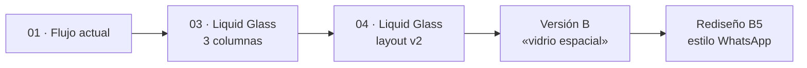

> [!abstract] En corto
> Tavernus se juega en una web propia. El chat ocupa el centro, con las ilustraciones dentro de los mensajes. Alrededor están la ficha, el tablero del lugar, el mapa y la hoja. El diseño pasó primero por un estilo «vidrio espacial» en Figma y después por un rediseño al estilo WhatsApp.

## Clientes

- **Web propia:** el producto. Funciona en ordenador y en móvil.
- **Discord:** el primer cliente. Desde el 21 de octubre ya no se usa.
- **REPL de terminal:** para desarrollo.

Todos usan **el mismo motor**. El motor no sabe qué cliente lo usa.

## El menú

- Fondo con la **taberna al amanecer** (ver [[Dirección de arte]]).
- Arriba, **«Continúa tu historia»** con la última partida.
- Pestañas **Partidas / Demos / Grabaciones**, con tarjetas. Cada tarjeta lleva una **sinopsis** de la partida.
- Las acciones secundarias (borrar, convertir en demo, jugar desde el principio) van en el botón «…» de cada tarjeta.
- **Nueva partida** abre una hoja con el formulario: nombre, mundo (la demo o uno generado), modo del máster, personaje propio y plazas para amigos.
- **Música** del menú en bucle, con botón de silencio que se recuerda. Ver [[Música y sonido]].

## La partida

- **El chat en el centro**, como una conversación de mensajería.
- Las **ilustraciones van dentro del chat**. Al pulsarlas se abren en grande (se cierran con la X, clic fuera o Esc).
- **Cabecera:** la hora de la partida, los demás jugadores con su presencia y los controles de voz y sonido.
- **Prólogo y «Donde lo dejamos»** salen como bloques de libro, a todo el ancho. Ver [[Prólogo]].
- **Avisos** de una línea (tablón, progreso) con enlace al Diario.
- **Al volver:** desde 30 min fuera de línea, la tarjeta «Mientras no estabas» al final del hilo; y la línea «Hasta aquí habías leído» antes de lo no leído.
- **Tablón:** en el menú del cubo y en el panel, los encargos disponibles y los cogidos, con quién los pide, recompensa y plazo. Abrirlo es leerlo, como `/tablon`.
- **Tiradas** como pastillas de color y un botón de dado animado.

**Redacción**

| Pieza | Qué hace |
|---|---|
| Cuadro «¿Qué haces?» | Texto libre |
| Atajos | Acciones sugeridas y comandos |
| Hacer / Decir | Cambia entre actuar y hablar a otro jugador (solo en multijugador) |
| Micrófono | Dictado por voz con el reconocimiento del navegador, sin coste |
| Pincel | Pide una ilustración del momento actual, con límite diario |
| Mochila | Abre Hoja / Diario / Mochila en una ventana, junto a Enviar |

## Hoja, Diario y Mochila

- **Hoja:** raza, clase, PG, CA, salvaciones, habilidades, modo de muerte y «Tu grupo».
- **Diario:** misiones, charlas por personaje, crónica y lugares. Las misiones van en tres pestañas: **En curso** (la que sigues como tarjeta grande con «qué toca ahora», progreso y plazo; las demás como filas de una línea), **Completadas** (cumplidas, perdidas o caducadas y rechazadas) y **Se dice** (rumores). Seguir una misión y dejarla son botones con texto al pie de cada una; la seguida es la del recuadro «Misión» del panel.
- **Mochila:** como el inventario de un juego de rol. Arriba, la carga con su barra (verde, ámbar al ir cargado, rojo muy cargado) y las monedas. En medio, un muñeco con cada hueco en su sitio del cuerpo: cabeza y cuello arriba; cuerpo y espalda o capa en el centro; mano principal, guantes y un anillo a la izquierda; otra mano, cinturón y el otro anillo a la derecha; pies abajo. Debajo, una rejilla de casillas fijas por contenedor (bolsillos, mochila…), con las libres a la vista. Todo se arrastra (con el dedo, manteniendo pulsado) o se coge y se deja con un clic, un toque o Enter; el motor dice si no cabe. La ficha de cada objeto (peso, daño o CA, propiedades y para qué sirve) sale al pasar por encima, al enfocarlo o al cogerlo, y se genera de sus datos. Ver [[Decisiones]].

## El tablero

Un plano **SVG** del lugar actual, dibujado desde los datos. Sin IA.

- Puntos, muebles y salidas del lugar, con una cuadrícula de 1,5 m.
- **Clic para moverse.** Pasar el ratón sobre un mueble enseña su punto.
- Solo enseña lo que tu personaje puede saber: los puntos ocultos aparecen cuando los descubres, y los muebles que los delatarían también.
- Encima, **solo personajes**: tú, los demás jugadores y los NPC que percibes. Junto a un NPC, con quién habla: «Hugo (con Aren)».
- Cada ficha lleva el **retrato** de esa persona (el avatar elegido, si es un PJ) dentro de un aro de color: dorado para ti, verde para un personaje y naranja para un PNJ. Si aún no hay retrato, se ve la inicial. A quien solo intuyes («figura», «movimiento») se le ve un «?», sin cara. Un retrato nuevo aparece sin recargar.
- «Cerca de ti» está en el **tablero ampliado**.
- Los planos se generan con la semilla del mundo y una plantilla por tipo de lugar. En la demo se pueden escribir a mano como datos.

## Mapa de zona y de región

- Un grafo de los lugares que **tu personaje conoce**: visitados u oídos.
- Dos vistas con los mismos datos: la **zona** (sus lugares y los vecinos de otras zonas) y la **región** (zonas y caminos entre ellas).
- Se dispone automáticamente desde los datos. Descubrir un lugar no mueve los demás.
- Encima, los personajes: tú, tu grupo y los NPC que percibes.
- Vale para la demo y para cualquier mundo generado. Ver [[Brezal#Mapa|Mapa de Brezal]].

## En el móvil

- Barra inferior con pestañas (Partida, Tablero, Mapa, Hoja).
- Dictado y narrador de voz para jugar con menos pantalla. Ver [[Narrador de voz]].

## El diseño en Figma

Archivo: [TAVERNUS en Figma](https://www.figma.com/design/DLtN2zFOjXqXO4qDTudun3/TAVERNUS).

| Etapa | Qué propuso |
|---|---|
| **01 · Flujo actual** | Las pantallas tal como estaban, para documentarlas |
| **03 · Liquid Glass (3 columnas)** | Chat del ancho de un móvil en el centro; a la izquierda el personaje (ficha, misión, grupo, mochila), a la derecha lo espacial (tablero, mapa, escena) |
| **04 · Liquid Glass · layout v2** | La escena como bloque principal y el chat flotando encima; panel lateral con ficha y pestañas Tablero / Mapa / Hoja |
| **Versión B, «vidrio espacial»** | Más sutil, según las guías de Apple: vidrio solo en controles y navegación flotantes; el contenido en superficies sin borde; nada de vidrio sobre vidrio |
| **P1B (elegida, 21 oct)** | El chat ocupa todo el centro y las imágenes van dentro de los mensajes, con modal al pulsar |

**«Vidrio espacial»:** paneles translúcidos sobre un fondo casi negro, con un único acento ámbar. Se implementó en la web el mismo día.

**Rediseño B5, estilo WhatsApp.** Después llegó una segunda vuelta:

- partida y menú al estilo de una app de mensajería;
- Manrope en los títulos;
- Hoja, Diario y Mochila en una ventana que se abre desde la mochila junto a Enviar;
- menú con sinopsis de cada partida y cristal oscuro;
- animación de entrada y fundidos entre páginas;
- tiradas como pastillas de color y dado animado;
- escuchar una narración desde el avatar, con un borde que late con la voz.

> [!note] Aprendizaje de Figma
> El efecto Glass sobre superficies grandes dibuja un canto marcado. Para las ventanas queda mejor el desenfoque de fondo.

## Relacionado

- [[Dirección de arte]] · [[Música y sonido]] · [[Narrador de voz]] · [[Multijugador]]
