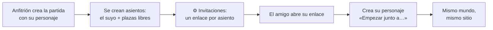

> [!abstract] En corto
> El motor nació multijugador: un mundo compartido, una cola de acciones por lugar y percepción por bandas. La web añade una identidad ligera sin cuentas: el anfitrión reparte un enlace por asiento y cada persona queda ligada a su personaje. Entre jugadores se habla, se da, se sigue y se ayuda sin gastar IA.

## Asientos e invitaciones

- **Asiento:** un hueco para un jugador, con su enlace y su personaje (o libre).
- Al crear la partida, «Plazas para amigos» dice cuántos asientos libres se crean (1 por defecto; hasta 8).
- Abrir el enlace deja al navegador **ligado a ese personaje**. No puede actuar ni mirar por otro.
- **Renovar** un enlace invalida el anterior y saca a quien lo usaba.
- Quien entra con asiento libre crea su personaje. «Empezar junto a…» lo pone al lado del anfitrión, ya conocidos, con una situación complementaria.
- Sin cuentas: perder el enlace es perder el acceso hasta que el anfitrión lo renueve.

**Modos de acceso**

| Modo | Para qué |
|---|---|
| Invitación | Por defecto en un servidor público. Solo entra quien tiene enlace |
| Público | Cualquiera entra al menú y crea partidas, en las que queda de anfitrión. Cada navegador ve solo las suyas. Límite de partidas nuevas al día |
| Abierto | En local, como siempre: cualquiera juega con cualquier personaje |

## Qué ve cada uno

- Cada suceso se entrega **por bandas de percepción** (ver [[Percepción]]). Cada pestaña recibe solo lo suyo.
- Los nombres que tu personaje no conoce se enmascaran.
- **Presencia** en la cabecera: iniciales de los demás, punto verde si están en línea, aro dorado si están contigo. «Kael está aquí», «Mira está en camino».
- No dice **dónde** está el otro: eso hay que descubrirlo jugando.
- En la hoja, el bloque **«Tu grupo»**.
- En el hilo: quién entra y quién sale de la partida.
- «está escribiendo…» de los que comparten sitio contigo.

## Entre jugadores, sin máster

Una prueba con dos jugadores en la herrería enseñó que el máster narraba lo que hacía el otro y cada frase gastaba IA. De ahí salieron estas acciones deterministas:

| Acción | Cómo | Coste |
|---|---|---|
| **Decir** | Botón «Hacer / Decir», o empezar por raya o comillas. `— (susurra) …` y `— (grita) …` cambian el volumen | 0 |
| **Dar** | «dar la daga a Aren». El otro ve Aceptar o Rechazar. Caduca a los 5 minutos | 0 |
| **Seguir** | «seguir a Aren». Sales tras él al mismo paso | 0 |
| **Ayudar** | «ayudar a Aren». Ventaja en su siguiente tirada, durante 10 minutos de juego | 0 |
| **Responder** | Si otro se dirige a ti, aparecen «Responder» e «Ignorarle» | 0 |
| **Reaccionar** | Si otro te agarra, te arrastra, te empuja o te ataca, decides tú: «Dejarse», «Resistirse» o tus palabras, en 90 s. Ver abajo | 0 (con máster, una narración del desenlace) |

- **El máster no actúa por otro jugador.** Si lo intenta, el cierre se rechaza.
- Lo que dice otro jugador te llega **literal**, con su avatar, si lo oyes bien.

## Reacciones

Antes, si un jugador agarraba a otro y se lo llevaba a la taberna, el máster lo resolvía sin preguntar. Ahora decide el afectado (26-10-2026).

- **Le llega** en su chat quién, qué intenta y lo que escribió: «Aren intenta agarrarte y llevarte a la Taberna del Jabalí. ¿Te dejas o te resistes?», con la cuenta atrás.
- **Quien actúa** ve «⏳ Esperando a que Mira decida…» y no hace otra cosa mientras, salvo hablar.
- **Dejarse:** sale sin tirada. Un golpe aceptado impacta sin tirada de ataque.
- **Resistirse:** tirada enfrentada del SRD, Atletismo contra el mejor de Atletismo o Acrobacias (el empate lo gana quien se resiste). Un ataque va contra la CA.
- **Con tus palabras:** «vale», «sí», «me dejo» es dejarse; lo demás es resistirse, y lo que dices acompaña.
- **Si no responde en 90 s,** se resiste por instinto. Ausente, igual y al momento. Dormido o inconsciente, no puede resistirse. Bajo el velo, nadie le toca.
- **Efectos:** si sale bien, los dos van al sitio, o queda agarrado o derribado, o recibe el daño. Con máster, este narra el desenlace a los dos.
- **Dar algo** sigue siendo una oferta, no una reacción.

## Varios a la vez en el mismo sitio

| Situación | Qué pasa |
|---|---|
| Dos acciones al máster a la vez | Cola por lugar. La segunda ve «Esperando a Mira…» |
| Dos acciones en sitios distintos | No se esperan entre sí |
| Doble clic o dos pestañas del mismo jugador | Se rechaza: «Ya tienes una acción en curso» |
| Coger el mismo objeto | El primero se lo lleva; el segundo ya no lo encuentra |
| Hablar con un NPC ocupado | «Esperar turno» o «Unirme a la conversación». En grupo, una sola respuesta para todos |
| Escena tensa | Rondas: el máster resuelve la ronda entera. Ver [[Combate]] |

### Quién lee qué en la sala

| Qué pasa | Quién lo lee entero | El resto de la sala |
|---|---|---|
| Lo tuyo (miras, rebuscas, hablas con un NPC a solas) | Tú | Un aviso gris de una línea: «Isgral habla con Hugo en voz baja», con «Unirme a la conversación» |
| Una charla con un NPC | Los que están en ella y a quien el NPC le habla. Cada frase dice a quién va: «a ti», «a Isgral», «a todos» | El aviso de una línea |
| Algo que afecta a todos (empieza una pelea, alguien entra, un estruendo, el NPC se vuelve hacia el grupo) | Todos, con la misma narración | Nadie se queda fuera; las charlas sueltas se cortan y el NPC atiende al grupo |

No hay «escuchar» una charla ajena: o te unes (el NPC lo sabe) o lo intentas a escondidas como una acción más.

## Desconexiones

El mundo es abierto: el reloj sigue mientras alguien juegue y cada uno entra cuando quiere. Para quien está fuera no pasa el tiempo: ver [[Tiempo y viaje#Si te desconectas]].

| Momento | Qué pasa |
|---|---|
| Cierras la pestaña | A los 20 s estás **ausente**. Tu personaje se queda donde estaba. Los de tu sitio leen «Leodhin se ha ido; su personaje se queda en el yunque» |
| Ausente en combate | No ataca ni gasta, pero se defiende. Si cae, queda estable: no muere ausente |
| Ausente en una ronda | Duda. Tras dos rondas seguidas, sale de ellas |
| 30 minutos fuera | Cae el **velo**: dormido y protegido. Deja de ser objetivo |
| Vuelves | El velo cae. «Donde lo dejamos» te cuenta lo que te afecta. Ver [[Prólogo]] |

- Las ofertas pendientes con un ausente se cancelan.
- Si se va el líder, quien le seguía deja de hacerlo.
- Un paso de misión lo dan también quienes estaban presentes. Un final cerrado sin ti abre tu «Donde lo dejamos».

## Cupos de gasto

- Con máster real, cada personaje tiene un **cupo diario**: 200 acciones por defecto.
- Al agotarlo, ese jugador sigue en **modo offline** hasta medianoche, con un aviso. Los demás no se ven afectados.
- Con Haiku 5.5, 200 acciones son unos 0,25 € por personaje y día; con Opus 5.5, unos 6 €.

## Lo que falta

| Qué | Prioridad |
|---|---|
| Avisos fuera de la web (no leídos, push o correo) | Deseable |
| Tope global de gasto por partida o servidor | Deseable |
| Cola de conversación con turno explícito | Deseable |
| Dificultad según el número de jugadores | Deseable |
| Reportar un error desde la web | Deseable |
| Robo a un durmiente, candados, guardias | Después |
| Crimen, testigos y ley entre jugadores (el ataque ya es una reacción) | Después |
| Compañías (alianzas formales) | Después |
| Cuentas de verdad | Después |

Hecho desde la auditoría: muerte y reaparición. Ver [[Muerte y descanso]].

## Relacionado

- [[Percepción]] · [[Combate]] · [[Interfaz]] · [[Mecánicas]]
