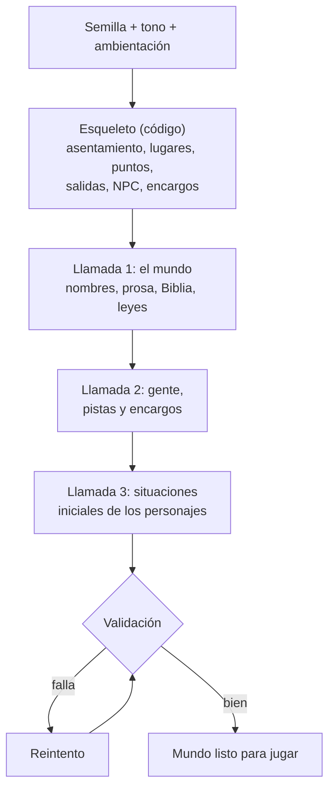

> [!abstract] En corto
> «Mundo nuevo» sustituye la aldea de la demo por un mundo hecho para esa partida. Primero el código elige, con una semilla, el tipo de asentamiento, sus lugares, sus NPC y sus encargos. Después tres llamadas a Claude ponen nombres, prosa, una Biblia de verdades ocultas y una situación inicial para tu personaje. Cuesta unos céntimos por mundo.

## La idea

- La demo de [[Brezal]] es un mundo escrito a mano. El producto son **mundos generados**.
- Cada partida nueva es un mundo distinto.
- **Misma semilla, mismo esqueleto.** Dos semillas, dos mundos.
- El esqueleto es código (cero tokens). La IA solo pone lo que exige lenguaje.

## Qué elige el jugador

En el menú, *Nueva partida → Mundo nuevo (generado)*: «Otro lugar, otra historia, y tu personaje con un porqué».

| Campo | Opciones |
|---|---|
| Semilla | Un número; vacía, al azar |
| Tono | Sombrío, Épico, Terror, Pulp, Cómico |
| Ambientación | Texto libre opcional: «Fantasía oscura, ciencia ficción, postapocalíptico…» |

## El catálogo de asentamientos

El catálogo tiene 14 tipos de asentamiento, unos 50 tipos de lugar y 45 papeles de NPC.

| Género | Asentamientos |
|---|---|
| Fantasía | Aldea · Puerto pesquero · Ciudad amurallada · Campamento minero · Monasterio · Caravana en marcha · Fortaleza fronteriza · Mercado de cruce de caminos · Pueblo abandonado · Asentamiento en cuevas |
| Ciencia ficción | Puerto espacial · Estación minera |
| Postapocalíptico | Refugio de supervivientes · Pueblo de chatarra |

Cada tipo define:

- lugares **obligatorios** y **opcionales** (4 a 6 en total);
- papeles de NPC fijos y una bolsa de opcionales (de 3 a 7 NPC);
- dos **exteriores** posibles (bosque, río, cruce, colinas, pantano, costa, paso de montaña…);
- bestias posibles en los exteriores (lobo, jabalí);
- un **peso por tono**: el tono hace más probables unos tipos que otros.

| Tono | Asentamientos que favorece (ejemplos) |
|---|---|
| Terror | Pueblo abandonado, monasterio, puerto pesquero |
| Sombrío | Campamento minero, monasterio, fortaleza |
| Épico | Ciudad amurallada, fortaleza fronteriza |
| Pulp | Caravana, puerto pesquero, ciudad amurallada |
| Cómico | Mercado de cruce, caravana, aldea |

## Cómo se genera

1. **Esqueleto.** Con la semilla, el código elige el asentamiento, sus lugares con puntos a partir de plantillas por tipo, las salidas, los papeles de NPC, los exteriores y los encargos.
2. **Relleno.** Tres llamadas a Claude con salida estructurada y esquemas pequeños (la API limita su tamaño): el mundo; la gente, las pistas y los encargos; las situaciones. Cada una lee lo que escribieron las anteriores.
3. **Validación.** Cada llamada se valida y se reintenta por su cuenta. Si aun así no cabe, se pide como JSON libre y se valida igual.
4. **Mapas.** Los planos del tablero se generan desde los datos, con variedad por semilla y una plantilla por tipo de lugar.

## Los vecinos de relleno

Además de los personajes con historia, cada mundo generado trae vecinos de relleno, como los [[Vecinos de Brezal]]: gente de paso con oficio, nombre, horario y casa, que hace pueblo sin pesar en la historia. Salen del tipo de asentamiento y de la semilla, sin IA y sin coste:

- **Qué oficios:** los de su lugar. La aldea tiene labradores, panadero, niños y beata; el puerto, pescadores y lavandera; la estación minera, perforadores y un vigilante; el pueblo abandonado, uno como mucho.
- **Dónde:** de día donde trabaja su oficio, por la tarde donde se junta la gente y de noche en las casas del centro, cerradas con llave («las casas», «los camarotes», «las chabolas», según el género).
- **Cómo hablan:** igual que en Brezal: dos frases frías, lo suyo (vender, indicar, la hora) y, de lo demás, a quién preguntar.

La misma semilla da los mismos vecinos, y los personajes con historia no cambian por tenerlos.

## La situación inicial

Para cada personaje, el relleno escribe una situación:

- **por qué** está aquí y qué quiere;
- un **plazo** (un reloj en días);
- un **antagonista**;
- **tres caminos** posibles;
- el **sitio y la hora** en que empieza.

Con «Empezar junto a…», el segundo jugador recibe una situación **complementaria**, no la misma repetida. El [[Prólogo]] la cuenta al empezar.

## La Biblia y las leyes

- La **Biblia** son 5-10 verdades del mundo que nada puede contradecir (quién es el antagonista real, qué pasó hace 200 años).
- Nunca va entera al máster: solo ve lo revelado. El prólogo tampoco la cuenta.
- Las **leyes del mundo** dicen si hay magia, qué tecnología existe y qué está prohibido. Ver [[Creatividad del máster]].

## Coste

| Qué | Coste |
|---|---|
| Relleno de un mundo con Sonnet 5.5 (modelo por defecto del generador) | Unos 0,07-0,15 $ |
| Sin clave o en offline | 0: sale un mundo de prueba, con estructura variada y nombres combinados, pero textos de plantilla |

- El generador **no usa el modelo del máster**: un modelo pequeño da mundos más pobres.
- Con Haiku, el relleno choca con el límite de gramática de la API y la partida sigue con un mundo offline.
- Hay un script para medir la petición sin llamar a la API.

## Hacia dónde va (plan)

El plan describe un mundo que **crece donde miran los jugadores**:

- Cada entidad pasa por resoluciones: desconocida → oída → esbozada → rellenada → visitada.
- Al cruzar hacia una zona esbozada, el destino y sus vecinos se rellenan **durante el viaje**. Si llegas antes, la llegada espera con narración de camino; nunca inventa.
- El máster podrá pedir que se genere algo que el esqueleto permite y aún no tiene contenido.
- Regiones y zonas por encima de las localizaciones, con mapa de región por jugador.
- Después, un **mundo vivo**: horarios, economía, líneas secundarias y el Director.

| Fase del plan | Objetivo |
|---|---|
| 1 · Generador desde semilla | Cada partida, un mundo distinto (hecho: «Mundo nuevo») |
| 2 · Generación perezosa y mapa de región | El mundo crece sin perder coherencia |
| 3 · Mundo vivo | El mundo cambia entre sesiones; la trama nace de lo que pasa |
| 4 · Presentación y persistencia | Imágenes por entidad, base de datos por partida, panel |
| 5 · Online y sociedad | Varias personas en un mundo generado durante semanas |

## Relacionado

- [[Creatividad del máster]] · [[El máster IA]] · [[Prólogo]] · [[Brezal]]
