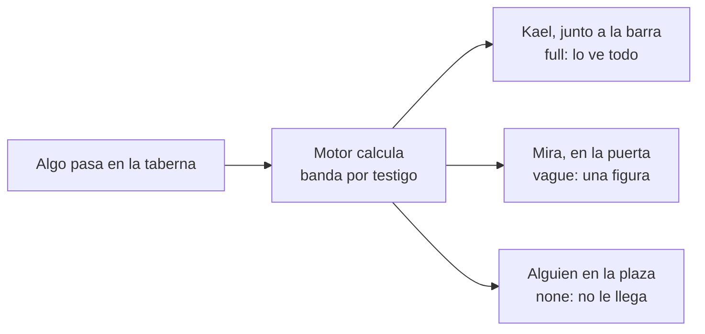

> [!abstract] En corto
> Cada personaje tiene un radio de visión y otro de oído que calcula el servidor. Más allá del radio, el detalle se degrada por bandas. El máster solo puede narrar hasta la banda que le corresponde a cada uno: no puede nombrar a quien apenas se distingue.

## Por qué importa

- Es lo que hace que cada jugador viva **su** mundo.
- No hay un canal común donde todos leen todo. Si no estás en un sitio, no te enteras.
- Es también la base de los testigos: quién vio qué, y con cuánto detalle.

## Los radios

**Visión** = base × luz × habilidad. Base: 30 m en un sitio abierto de día.

| Luz | Factor |
|---|---|
| Día | 1 |
| Crepúsculo | 0,5 |
| Noche con luna | 0,25 |
| Noche cerrada | 0,05 |
| Antorcha propia | 0,2 + 10 m fijos |

- La **visión en la oscuridad** de algunas razas ignora la falta de luz hasta 18 m.

**Oído** = base × ruido ambiente × habilidad.

| Sonido | Alcance base |
|---|---|
| Conversación normal | 20 m |
| Grito | 100 m |
| Campanas | 300 m |

- Lluvia, mercado o combate reducen lo que oyes.
- **Habilidad:** sale de la Percepción pasiva. Con 10, ×1; cada punto suma o resta un 5 %. Un explorador con 17 percibe un 35 % más lejos.
- **Dormido:** ×0,2.
- Paredes y puertas cerradas cortan la vista y apagan el sonido.

## Las cuatro bandas

El radio marca hasta dónde percibes **bien**. Más allá, no hay corte seco: el detalle se degrada.

| Distancia | Banda | Ves | Oyes |
|---|---|---|---|
| Hasta 1 radio | `full` | Quién es, qué hace, qué lleva | Palabras y tono |
| De 1 a 2 radios | `vague` | Forma y acción, sin identidad: «una figura se agacha junto al roble» | Que hablan y el tono, sin palabras |
| De 2 a 3 radios | `hint` | Solo presencia: «algo se mueve entre los árboles» | Un ruido, sin saber qué |
| Más de 3 radios | `none` | Nada | Nada |

- El servidor calcula la banda de cada cosa presente y se la pasa al máster.
- El máster **solo narra hasta ese nivel**.
- Acercarse o una tirada de Percepción suben de banda.
- Dentro de `full`, lo sutil (un susurro, alguien escondido) sigue pidiendo tirada.

## Vista y oído van por separado

- **El habla va por el oído; los gestos, por la vista.** Ver a alguien susurrar no te da lo que dice.
- Si oyes bien a otro jugador, recibes sus palabras literales. Si oyes peor: «Oyes a alguien hablar, pero no entiendes qué dice».

## Lo que ven los testigos

- Cada suceso tiene dos textos: el del **actor** y el **observable** para los demás.
- Los testigos ven la acción física y lo dicho en voz alta. Nunca las tiradas, lo que el otro descubre ni sus secretos.
- Si Mira encuentra una trampilla, tú ves «Mira palpa la pared», no «Mira encuentra una trampilla».
- Los nombres que tu personaje no conoce se enmascaran: «un humano con pinta de pícaro habla con la tabernera».

## Rincones que se ven y rincones que se descubren

Como en Baldur's Gate 3 (ver [[Modelo Baldur's Gate 3]]), un sitio no se conoce entero al cruzar la puerta.

- **De un vistazo**, desde donde está, el personaje conoce lo que tiene a la vista. Los datos lo pueden afinar: la mesa del fondo del [[Taberna del Jabalí|Jabalí]] está en penumbra y no se ve desde la puerta; la escalera del cuarto, sí. Si los datos no dicen nada, cuenta lo de la misma estancia, sin una pared en medio. Cada sitio por el que pasa suma lo que se ve desde él.
- **Mirando alrededor** ve el resto de la estancia, y lo oculto si su Percepción pasiva llega a la CD.
- **Si alguien se lo nombra** («la trampilla de la mesa del fondo»), lo sabe aunque esté oculto.
- **Buscando**, con una tirada de Percepción o Investigación contra la CD.
- Las sugerencias, el tablero y el mapa solo enseñan lo conocido. El máster sabe qué falta por ver y qué está oculto, pero no puede contarlo sin tirada ni alguien que lo enseñe.

## Nombres que se aprenden

- Se aprende un nombre cuando el NPC lo dice («Brenna. ¿Qué te pongo?»), cuando otro lo nombra estando delante («Hugo, ponle otra») o cuando la narración lo presenta.
- Hasta entonces la narración usa el oficio: «el martilleo del herrero». Lo que dicen otros entre comillas se oye tal cual.

## Relacionado

- [[Mecánicas]] · [[Tiempo y viaje]] · [[Multijugador]] · [[El máster IA]]
