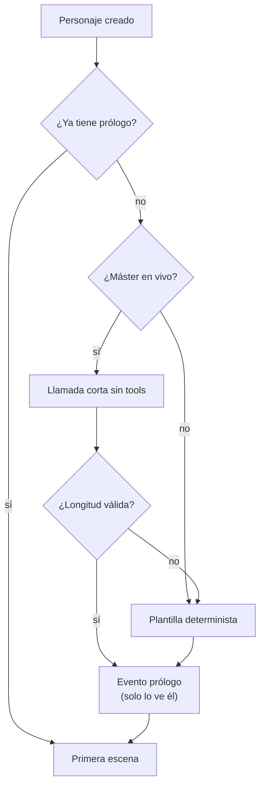

> [!abstract] En corto
> Cada personaje empieza con un prólogo corto, de 60 a 120 palabras: dónde está y cuándo, por qué está aquí, qué le amenaza y cuánto tiempo tiene. Remata con «Empieza tu aventura». Después, el narrador abre la primera escena. Quien vuelve tras días sin jugar recibe «Donde lo dejamos»: dónde está, qué hacía, qué tiene pendiente y qué pasó mientras tanto.

## El problema

- La primera escena empezaba en el instante y acababa en «¿qué haces?». Bien para jugar ya, pero quien llega no sabe qué mundo es este ni por qué ha venido.
- Quien vuelve tras una semana encuentra el hilo donde lo dejó, sin acordarse de a quién debía dinero ni cuánto plazo le quedaba.

## Qué cuenta el prólogo

Desde el 28-10, con situación inicial, **solo lo suyo**, en dos párrafos:

1. **El lugar y el momento:** dónde está y cuándo («Es lunes 1 de Brotes, al caer la tarde. Estás en la mesa del fondo…»).
2. **Su situación:** por qué está aquí, qué le amenaza, cuántos días quedan y qué pasa si vence.

Debajo del remate, «Empieza tu aventura». Sin situación inicial (la demo), además el mundo y su tono, y el origen en tercera persona.

> [!note] Por qué se cambió
> La primera versión abría con la historia de Brezal (el incendio de Vharn) y nombraba a Brenna y a Garrán antes de que el jugador les pusiera cara. Se leía como un resumen de lore, no como una entrada en la partida. Ver [[Decisiones]].

**Lo que no cuenta**

- La **Biblia**, los secretos de los NPC ni cómo se descubren las pistas. Se descubren jugando.
- Los **caminos**: son decisiones del jugador y nombran a gente que aún no conoce.
- El **primer instante**: eso abre la primera escena.
- La **historia del sitio** (la premisa): se descubre jugando.
- **Nombres:** solo el del antagonista, presentado por lo que es («Garrán, el alguacil del regidor»). El resto, por su oficio («la tabernera te dio cama»), aunque la situación diga que los conoce.

## Con qué voz

- **Una apertura de libro**, no una burbuja del narrador.
- Bloque propio a todo el ancho, sin avatar, con el rótulo «Prólogo», un título de capítulo en tipografía de libro («Capítulo 1: …») y letra capital.
- **Segunda persona y presente**, como el resto de la partida.
- Se lee en alto con el [[Narrador de voz]].
- Después, la primera escena es **más corta** (unas 50 palabras) y no repite nada.

## Cómo se genera

- **Una sola vez por personaje**, al pedir su primera escena. Queda en el log y no se reescribe.
- Con máster en vivo: una llamada corta, sin tools. Con Haiku cuesta menos de un céntimo.
- Si la respuesta sale vacía, corta o larga, se usa la **plantilla**.
- En offline o sin máster, la plantilla, con los mismos datos.
- El **Diario** abre con una entrada de capítulo: el título y la primera frase.

## «Donde lo dejamos»

**Cuándo sale.** Al abrir la partida, si desde el último evento del propio personaje:

- han pasado más de **72 horas reales**, o
- han pasado **7 días de juego** (unas 56 horas reales).

También sale antes si te fuiste y pasó algo que te afecta (combate en tu sitio, rondas resueltas sin ti, algo dirigido a ti, un final cerrado sin ti) o si el mundo te ha sacado 1 h de juego o más mientras no estabas: tu reloj estaba parado y empieza por «El tiempo». Una recarga no la provoca. Solo sale una vez por ausencia.

**Qué cuenta.** Todo sale del Diario y del log, sin IA:

| Bloque | Contenido |
|---|---|
| Lo que te pasó | Si caíste o moriste: quién te salvó, dónde quedó tu cuerpo, qué falta |
| Dónde estás | Lugar, día y hora de juego |
| Lo último que hiciste | Tu última acción y lo que pasó |
| Misiones | Las abiertas; la principal con su reloj («quedan 3 días») |
| Deudas | Las abiertas, con su plazo |
| Gente | A quién conoces y lo último que te dijo (las tres conversaciones más recientes) |
| Entretanto | Anuncios, cambios del tablón y lo que te llegó sin actuar |

- **Pulido opcional:** el máster puede contarlo en prosa con una llamada corta. Apagado por defecto: la plantilla ya cuenta lo esencial y no cuesta nada.
- Se ve como bloque de libro con el título «Donde lo dejamos» y se lee en alto.

## Relacionado

- [[Mundos generados]] · [[Muerte y descanso]] · [[Multijugador]] · [[Historia]]
