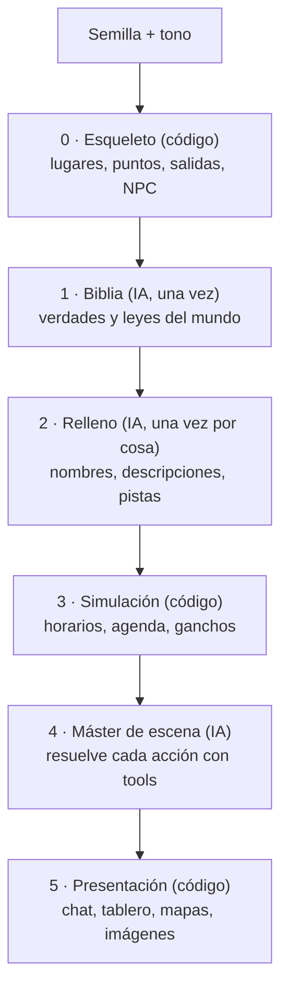

> [!abstract] En corto
> Tavernus es un juego de rol por chat, con reglas de D&D 5e (SRD) y un máster de IA (Claude). El mundo vive en una base de datos; la IA narra y propone, y el motor decide lo que pasa. La demo es la campaña «Brezal sellada», en la aldea de [[Brezal]].

## Qué es Tavernus

- Un juego de rol **por chat**: escribes lo que haces y un narrador te cuenta qué pasa.
- Las reglas son las de **D&D 5e**, en su versión libre (SRD): características, habilidades, tiradas contra dificultad, puntos de golpe.
- El máster es **una IA** (Claude). Narra, interpreta a los NPC y pide tiradas.
- Es **multijugador**: varias personas en el mismo mundo, cada una con su punto de vista.
- Se juega en una **web propia**, en ordenador o móvil. Empezó como bot de Discord, que ya se ha retirado.

La visión del plan: cada partida nueva es un **mundo distinto**, generado al empezar, que crece solo donde los jugadores miran, recuerda todo lo que pasa y sigue vivo entre sesiones. La taberna de Brezal es la prueba de concepto; el producto es el generador más el simulador que la rodean.

## Principios de diseño

| Principio | Qué quiere decir |
|---|---|
| **La base de datos es la verdad** | Solo existe lo que está en los datos. Lo que no está, no se narra. El máster solo cambia el mundo con herramientas (tools). |
| **La IA propone, el motor dispone** | Todo efecto pasa por el motor, que valida, calcula y lo registra. La IA no tira dados ni mueve a nadie por su cuenta. |
| **Generación perezosa y persistente** | No se genera el mundo entero. Se genera lo que alguien está a punto de ver, una sola vez, y queda guardado con su procedencia. |
| **Determinista donde se pueda** | Mapa, movimiento, dados, horarios, economía y acciones triviales son código. La IA se reserva para lo que exige lenguaje. |
| **El coste por acción es una métrica de diseño** | No es una factura que se mira al final. Objetivo: menos de 1 a 2 céntimos por acción en partida real; menos de 0,2 en pruebas. |
| **Reproducible** | Semilla fija para el mundo y los dados. Las respuestas del máster se pueden grabar y repetir: mismo recorrido, mismo resultado. |

> [!info] La regla de oro
> «La base de datos es la verdad; el máster IA solo puede cambiarla a través de tools.» Todo lo demás sale de aquí: el mapa canónico, la percepción por bandas, los dados del servidor, el log de eventos.

## Las capas del mundo

El plan ordena el juego en capas. Las de abajo son código; la IA entra donde hace falta lenguaje.

## Páginas de esta sección

**Cómo se juega**
- [[Mecánicas]]: lo básico desde el punto de vista del jugador.
  - [[Tiempo y viaje]]: el reloj a 3× y el movimiento que cuesta tiempo.
  - [[Percepción]]: qué ves y oyes según luz, distancia y ruido.
  - [[Combate]]: combate conversacional y ventanas decisivas.
  - [[Muerte y descanso]]: caer, morir, volver y dormir.
- [[Creación de personaje]]: razas, clases, trasfondos y array estándar.

**El máster y el mundo**
- [[El máster IA]]: cómo narra, sus tools y cuánto cuesta.
- [[Creatividad del máster]]: lo imposible, los rumores y el Director.
- [[Mundos generados]]: el catálogo de asentamientos y cómo nace un mundo.
- [[Multijugador]]: cuentas, biblioteca de personajes, asientos, invitaciones y jugar con amigos.

**Lo que se ve y se oye**
- [[Interfaz]]: menú, partida, tablero, mapas y diseño en Figma.
- [[Dirección de arte]]: estilo, paleta e imágenes por entidad.
- [[Música y sonido]]: ambientes, efectos y música del menú.
- [[Narrador de voz]]: el máster leído en alto.
- [[Prólogo]]: cómo empieza cada historia y «Donde lo dejamos».

**Aprendizaje**
- [[Lo que aprendimos jugando]]: observaciones de las pruebas con personas.

## La demo

La campaña de demo es «Brezal sellada». Ver [[Brezal]], [[Historia]], [[Personajes]], [[Brezal]], [[Brezal#Mapa|Mapa de Brezal]], [[Misiones]], [[Pistas]], [[Encargos del tablón]] y [[Taberna del Jabalí]].
