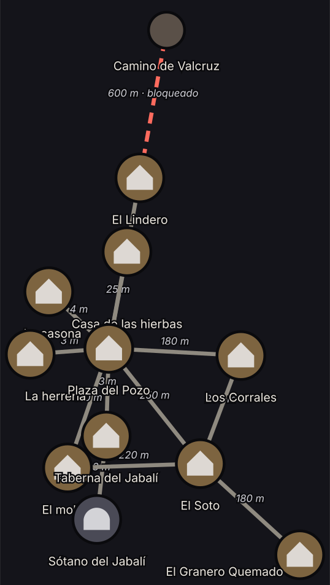

![[ilustracion-portada-brezal.jpg]]
*Brezal al anochecer, con la taberna encendida y la montaña de Vharn al fondo.*

**Brezal** es una aldea pequeña del valle de Vharn, al pie de la montaña de los antiguos señores. Es el único sitio jugable de la demo: once lugares, todos a menos de 600 metros de la plaza.

El pueblo gira alrededor de la [[Plaza del Pozo]], con su tablón y su agua turbia. A dos pasos están la [[Taberna del Jabalí]], [[La herrería]], [[La tienda del buhonero]] y [[La casona]] del regidor, y por un callejón, la [[Casa de las hierbas]] de la curandera. Dos caminos llevan a [[El molino]], junto al arroyo, y a la granja de [[Los Corrales]]. El portón norte da a [[El Soto]], la arboleda del borde, y por él se sube a [[El Lindero]]. Desde el Soto, una senda baja a las ruinas de [[El Granero Quemado]].

Desde hace tres semanas la aldea tose ceniza. El arroyo baja tibio y gris, las ovejas tosen y [[El Cerco de Ceniza]] cierra el valle a unos 600 metros de la plaza. Al otro lado queda el [[Camino de Valcruz]], adonde nadie llega.

> Las puertas de Brezal siguen abiertas. Es el mundo el que se ha cerrado.

## Los lugares

Cada lugar tiene su página, con ficha, puntos de interés, quién está ahí y las pistas y misiones que pasan por él.

| Lugar | Tipo | Cómo es | Quién suele estar |
|---|---|---|---|
| [[Plaza del Pozo]] | Exterior | El agua del cubo sale turbia. La niebla asoma sobre los tejados del norte. | [[Garrán]] en el tablón, [[Doro]] en el portón, [[Osric Malvez]] por la tarde; mercado, diezmo y misa |
| [[Taberna del Jabalí]] | Interior | Cerveza, humo y la manta vacía del perro de Brenna. Debajo, el [[Sótano del Jabalí]]. | [[Brenna]]; por la tarde [[Garrán]]; de noche [[Doro]] y [[Hugo]] |
| [[Sótano del Jabalí]] | Interior | Techo bajo, olor a tierra y a vino agrio. Cajas tapadas con sacos y un sello que nadie nombra. Solo se baja por la trampilla de la taberna. | Nadie |
| [[La herrería]] | Interior | Calor y hierro. El taller de Hugo. | [[Hugo]] |
| [[La tienda del buhonero]] | Interior | Una casa vacía de la plaza con estantes medio vacíos y el carro sin mula a la puerta. Abre de 9:00 a 19:00. | [[Lucio Cendal]] |
| [[La casona]] | Interior | La casa del regidor. Muebles demasiado buenos y una torre del reloj. | [[Osric Malvez]]; de noche [[Garrán]] |
| [[Casa de las hierbas]] | Interior | Ilse hierve corteza para la tos. | [[Ilse]] |
| [[El molino]] | Interior | El agua sale tibia y gris. | [[Mateo]] y [[Tobías]] |
| [[Los Corrales]] | Exterior | La granja de Úrsula: gallinas pardas y ovejas que tosen. | [[Úrsula]] |
| [[El Soto]] | Exterior | Arboleda y arroyo en el borde del pueblo. Ahí vive Hal. | [[Hal]], [[Tobías]] por la tarde, lobos ([[Criaturas]]) y [[Ceniza]] |
| [[El Granero Quemado]] | Exterior | Las ruinas del granero de los Vharn. Ceniza tibia y resplandor rojo. | Alguien vive en el pajar |
| [[El Lindero]] | Exterior | El borde del valle. La niebla quieta, sin olor, que apaga los sonidos. | [[Doro]] por la tarde; vecinos que prueban la niebla a las 22:00 |
| [[Camino de Valcruz]] | Exterior | Al otro lado de la niebla. Nadie llega hasta él en la demo. | Sellado: más allá del Cerco |

## Mapa

![[ilustracion-mapa-valle.jpg]]
*El valle de Vharn: la aldea al pie de la montaña, rodeada por la niebla.*

*El mapa de zona tal como lo dibuja el juego. La línea roja punteada es el Cerco.*

### Conexiones

Las salidas unen un punto de un lugar con un punto de otro. El tiempo es aproximado: a pie, a paso normal, en tiempo de juego.

| Desde | Punto de salida | Hasta | Punto de llegada | Distancia | Terreno | Tiempo a pie |
|---|---|---|---|---|---|---|
| [[Taberna del Jabalí]] | la puerta | [[Plaza del Pozo]] | la puerta de la taberna | 3 m | normal | 2 s |
| [[Taberna del Jabalí]] | la trampilla | [[Sótano del Jabalí]] | la escalera | 3 m | normal | 2 s |
| [[Plaza del Pozo]] | la puerta de la herrería | [[La herrería]] | la puerta | 3 m | normal | 2 s |
| [[Plaza del Pozo]] | la puerta de la casona | [[La casona]] | la puerta | 4 m | normal | 3 s |
| [[Plaza del Pozo]] | la puerta de la tienda del buhonero | [[La tienda del buhonero]] | la puerta | 3 m | normal | 2 s |
| [[Plaza del Pozo]] | el callejón de las hierbas | [[Casa de las hierbas]] | la puerta | 25 m | normal | 17 s |
| [[Plaza del Pozo]] | el camino del molino | [[El molino]] | la puerta | 150 m | normal | 1 min 40 s |
| [[Plaza del Pozo]] | el camino de los corrales | [[Los Corrales]] | la cancela | 180 m | normal | 2 min |
| [[Plaza del Pozo]] | el portón norte | [[El Soto]] | el sendero | 250 m | algo lento (×0,9) | 3 min |
| [[Plaza del Pozo]] | el portón norte | [[El Lindero]] | el final del camino | 450 m | algo lento (×0,9) | 5 min 30 s |
| [[El molino]] | la rueda | [[El Soto]] | el arroyo | 220 m | lento (×0,8) | 3 min |
| [[Los Corrales]] | el redil | [[El Soto]] | el roble viejo | 200 m | algo lento (×0,9) | 2 min 30 s |
| [[El Soto]] | la senda del granero | [[El Granero Quemado]] | el portalón caído | 180 m | lento (×0,8) | 2 min 30 s |
| [[El Lindero]] | el borde de la niebla | [[Camino de Valcruz]] | el camino de Valcruz | 600 m | — | **bloqueada** |

> [!note] El Cerco de Ceniza
> La salida del [[El Lindero|Lindero]] hacia Valcruz está bloqueada por el Cerco. Quien intenta cruzarla se mete en la niebla y sale por donde entró, **una hora de juego después**, con ceniza en el pelo. Lo resuelve el motor, no el narrador. Solo se puede intentar desde el Lindero. Más en [[Leyes del mundo]].

### Cómo se viaja

- **Nunca es instantáneo.** El servidor calcula la ruta más corta y el tiempo; el narrador solo lo cuenta.
- **La fórmula**: tiempo = distancia ÷ (velocidad × terreno × ritmo) + coste de entrada del punto. A paso normal se anda a 1,5 m/s.
- **Ritmo**: andar (×1), correr (×2) o ir con sigilo (×0,5). La carga y el estado del personaje también frenan.
- **Tiempo real**: el reloj del juego corre a 3×. Una hora de juego son 20 minutos reales. Ir de la plaza al Lindero (unos 5 min 30 s de juego) cuesta casi 2 minutos reales.
- **Encuentros de camino**: en los trayectos puede salir un vecino con tos, la ronda de [[Garrán]], ceniza que cae o un lobo entre las cercas. Ver [[Vida del pueblo]].

### Puntos dentro de cada lugar

- Cada lugar tiene varios **puntos** con coordenadas en metros. Dentro de un lugar, todos los puntos se conectan en línea recta.
- El **primer punto** de cada lugar es la entrada.
- Algunos puntos tienen **coste de entrada**: subir a la habitación del Jabalí o a la alcoba de la casona (20 s), al tejado del molino (30 s) o a la torre del reloj (40 s).
- Algunos tienen **aforo**: por la trampilla o el desván solo cabe una persona.
- Hay puntos **apartados**: desde la habitación de arriba, la alcoba o la torre no se ve ni apenas se oye el resto de la sala.
- Hay puntos **ocultos** (con una CD para encontrarlos) y puntos **cerrados con llave**. Cada página de lugar los lista.
- Cada punto tiene **alias**: se puede decir «voy al pozo» o «salgo hacia Casa de las hierbas» y el motor lo entiende sin gastar IA.

## Calendario y tiempo

- La partida empieza a las **18:00 del primer día**. Dos horas después hay misa en el pozo.
- El tiempo de juego corre **tres veces** más rápido que el real.
- Semana de siete días, de lunes a domingo.
- Cuatro meses de 30 días: **Brotes**, **Espigas**, **Cenizas** y **Escarcha**.
- Sale el sol a las 6:00 y se pone a las 20:00, con una hora de crepúsculo.

Lo que pasa cada día está en [[Vida del pueblo]].

## Ver también

- [[Historia]]: premisa, tono y lo que pasó antes de la partida.
- [[Vida del pueblo]]: horarios, rumores y los días de la partida.
- [[Situaciones iniciales]]: cómo llega cada personaje.
- [[Facciones]], [[Leyes del mundo]], [[Personajes]] y [[Misiones]].
