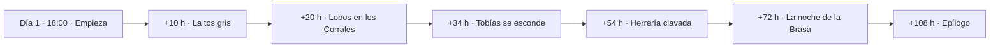

![[ilustracion-amenaza.jpg]]
*La noche de la Brasa: el ascua cae sobre la plaza mientras la niebla cerca el pueblo.*

La Brasa respira aunque nadie mire. Si el jugador no actúa, la amenaza **avanza sola** en tres días: el pueblo enferma, los lobos entran en los Corrales, Tobías se esconde, la herrería se cierra y el ascua cae en la plaza.

El reloj empieza a las **18:00 del día 1**. Son 72 horas de juego, unas 24 horas reales al ritmo 3×. El Diario enseña el reloj al jugador.

Cada escalón se evita si antes se ha cumplido algo concreto.

## La escalada

| Cuándo | Escalón | Dónde | Se evita con |
|---|---|---|---|
| +10 h (día 2, 04:00) | La tos gris | [[Plaza del Pozo]] | [[Acto II · Lo que esconde Brezal#El hijo del molinero\|El hijo del molinero]] |
| +20 h (día 2, 14:00) | Los lobos bajan a los Corrales | [[Los Corrales]] | [[Acto I · Lo que trae el agua#Ceniza se ha perdido\|Ceniza se ha perdido]] o la loba muerta |
| +34 h (día 3, 04:00) | Tobías se esconde en el granero | [[El molino]] | *El hijo del molinero* o la pista de las cartas |
| +54 h (día 4, 00:00) | Garrán clava la herrería | [[La herrería]] | [[Acto II · Lo que esconde Brezal#La cadena de hierro frío\|La cadena de hierro frío]] o llevar los eslabones |
| +72 h (día 4, 18:00) | La noche de la Brasa | [[Plaza del Pozo]] | Cualquiera de los tres finales |
| +108 h (día 6, 06:00) | Epílogo | [[El Lindero]] | No se evita |

## Qué pasa en cada escalón

> [!warning]- Spoiler: La tos gris
> Junto al pozo, una mujer tose y escupe gris; su crío también. Alguien grita que el agua está maldita y dos vecinos llegan a los empujones. Media aldea tose y hay cola en la [[Casa de las hierbas]]. Corre el rumor de la maldición del pozo: los de Vharn han maldecido el agua desde la tumba, y la niebla es la tapa.

> [!warning]- Spoiler: Los lobos bajan a los Corrales
> Los lobos saltan la cerca: el gallinero reventado, plumas por todas partes, dos ovejas muertas en el redil y huellas enormes, de ceniza, en la cancela. [[Úrsula]] está en medio con una horca. El lobo flaco se queda en el redil. Corre por la taberna el rumor de la loba de ceniza, grande como un poni. Ver [[Criaturas]].

> [!warning]- Spoiler: Tobías se esconde en el granero
> [[Mateo]] da voces por el molino: Tobías no ha vuelto y en el desván falta su manta. [[Tobías]] pasa a vivir en la era de [[El Granero Quemado]] y deja de hacer su ronda nocturna por el arroyo.

> [!warning]- Spoiler: Garrán clava la herrería
> [[Garrán]] clava dos tablas en cruz sobre la puerta de la herrería y cuelga el sello del regidor. La salida queda bloqueada. [[Hugo]] mira desde la puerta del Jabalí sin decir nada y se queda bebiendo en la mesa del fondo.

> [!warning]- Spoiler: La noche de la Brasa
> Del Granero Quemado sube una columna de chispas que choca con la niebla y cae sobre Brezal como ceniza caliente. El cielo de la plaza se pone rojo. El pasadizo bajo el altar brilla blanco, como hierro en la fragua. En el Jabalí entra una luz roja por la ventana.
>
> **[[Ysolde]] cruza la plaza con el ascua desnuda en la mano y se planta en el pozo.**
>
> A la media hora, la ceniza prende el tejado de paja de una casa junto al pozo. Hay gente dentro. Quien esté en la plaza tiene que decidir ya: cubos, gritos o correr. Ysolde mira la casona.
>
> La plaza se vuelve **escena tensa**: con dos o más jugadores, se juega por rondas.

## El epílogo

Al amanecer del día 6, pase lo que pase, la niebla sigue en el Lindero. Lo único que cambia es cómo, según el final cumplido. Ver [[Acto III · La noche de la Brasa#Epílogo común|Epílogo común]].

A cada personaje le cuenta además lo que ha cumplido, su final o que el ascua sigue sin decidir, lo que deja pendiente y que la historia queda abierta: se puede seguir jugando. *(Programado el 31-10-2026, sin probar con modelo.)*

El epílogo solo se evitaría si el Cerco se abriera, y eso queda para la expansión.
